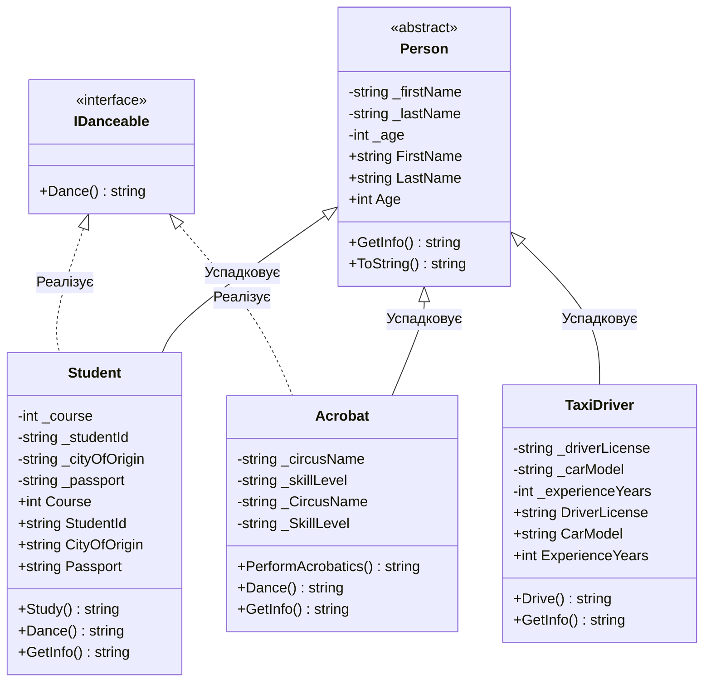

# Лабораторна робота №1 (Модуль 3, Лаб 3.1)

> **Дисципліна:** Об'єктно-орієнтоване програмування (C# / .NET 8)  
> **Тема:** Дослідження роботи з файлами та проектування зв'язків між сутностями  
> **Варіант:** 2  

---

## 📋 Зміст
1. [Постановка завдання](#-постановка-завдання-варіант-2)
2. [Архітектура та структура проєкту](#-архітектура-та-структура-проєкту)
3. [Діаграма класів (UML / Mermaid)](#-діаграма-класів-uml--mermaid)
4. [Основні реалізовані концепції ООП](#-основні-реалізовані-концепції-ооп)
5. [Формат збереження даних у файл](#-формат-збереження-даних-у-файл)
6. [Інструкція із запуску та тестування](#-інструкція-із-запуску-та-тестування)
7. [Відповіді на контрольні запитання (15 питань)](#-відповіді-на-контрольні-запитання)
8. [Шпаргалка студента для успішного захисту](#-шпаргалка-студента-для-успішного-захисту)

---

## Постановка завдання (Варіант 2)

1. **Сутності предметної області:**
   - Базовий клас: `Person` (Людина: ім'я, прізвище, вік).
   - Похідні класи:
     - `Student` (Студент: прізвище, ім'я, курс, студентський квиток, місто прибуття, серія та номер паспорту).
     - `TaxiDriver` (Водій таксі: посвідчення водія, модель авто, стаж).
     - `Acrobat` (Акробат: цирк/трупа, рівень майстерності).
2. **Додаткова властивість / поведінка:**
   - Здатність танцювати через спільний інтерфейс `IDanceable` з методом `Dance()`, який реалізують непов'язані спільним прямим предком сутності `Student` та `Acrobat`.
3. **Специфічні методи класів:**
   - `Student.Study()` — процес навчання студента.
   - `TaxiDriver.Drive()` — процес перевезення пасажирів водієм таксі.
   - `Acrobat.PerformAcrobatics()` — виконання акробатичних трюків.
4. **Розрахункова аналітична частина (Варіант 2):**
   - **Обчислити відсоток студентів 1-го курсу, які приїхали з інших міст**, та отримати їхні дані з файлу.
5. **Особливі технічні обмеження:**
   - ⚠️ **Сувора заборона стандартних колекцій** (`List<T>`, `ArrayList`, `Dictionary` тощо). Уся робота ведеться виключно через низькорівневі одновимірні масиви `T[]` з ручним виділенням пам'яті та копіюванням (`Array.Copy`).
   - Валідація користувацького вводу через регулярні вирази (`System.Text.RegularExpressions.Regex`).
   - Збереження та відновлення даних за допомогою файлових потоків введення-виведення (`FileStream`, `StreamReader`, `StreamWriter`) у спеціальному дужковому форматі.

---

## 🏛️ Архітектура та структура проєкту

Рішення організовано за трирівневою модульною структурою:

```text
labs/Lab01/
├── Lab01.sln                       # Рішення Visual Studio / JetBrains Rider
├── README.md                       # Звіт, документація, відповіді на питання та шпаргалка
├── src/
│   ├── Lab01.Core/                 # Бібліотека класів (доменна бізнес-логіка)
│   │   ├── Models/
│   │   │   ├── Person.cs           # Базовий абстрактний клас
│   │   │   ├── IDanceable.cs       # Інтерфейс танцювальної поведінки
│   │   │   ├── Student.cs          # Студент (варіант 2)
│   │   │   ├── TaxiDriver.cs       # Таксист
│   │   │   └── Acrobat.cs          # Акробат
│   │   ├── Common/
│   │   │   └── ArrayHelper.cs      # Робота з сирими масивами T[] без колекцій
│   │   ├── Validation/
│   │   │   └── ValidationHelper.cs # Валідація квитків, паспортів, імен через Regex
│   │   ├── Services/
│   │   │   └── StudentAnalytics.cs # Обчислення відсотка іногородніх першокурсників
│   │   └── IO/
│   │       └── CustomFileService.cs# Читання/запис кастомного формату через FileStream
│   └── Lab01.App/                  # Консольний інтерфейс користувача (CLI)
│       ├── Program.cs              # Точка входу
│       └── ConsoleMenu.cs          # Інтерактивне меню з покроковою валідацією
└── tests/
    └── Lab01.Tests/                # Модульні тести xUnit (61 тест)
        ├── Core/
        │   ├── ModelTests.cs
        │   └── ArrayHelperTests.cs
        ├── Validation/
        │   └── ValidationHelperTests.cs
        ├── Services/
        │   └── StudentAnalyticsTests.cs
        └── IO/
            └── CustomFileServiceTests.cs
```

---

## 📊 Діаграма класів (UML / Mermaid)



---

## 💡 Основні реалізовані концепції ООП

1. **Інкапсуляція:**
   - Приватні поля (`_firstName`, `_course`, `_studentId` тощо) захищені публічними властивостями.
   - Сеттери властивостей містять логіку валідації (неможливо створити студента з віком менше 15 років або некоректним квитком).
2. **Спадкування:**
   - Класи `Student`, `TaxiDriver` та `Acrobat` повторно використовують загальні властивості (`FirstName`, `LastName`, `Age`) та методи базового класу `Person`.
3. **Поліморфізм:**
   - **Через віртуальні методи базового класу:** Метод `GetInfo()` оголошений віртуальним у `Person` та перевизначений (`override`) у `Student`, `TaxiDriver`, `Acrobat`. Масив `Person[]` дозволяє викликати `GetInfo()` для кожного об'єкта зі збереженням його унікальних даних.
   - **Через інтерфейси:** Непов'язані класи `Student` та `Acrobat` реалізують інтерфейс `IDanceable`. У масиві `IDanceable[]` кожен з них виконує танець по-різному (студент танцює вальс, а акробат — акробатичний танець).
4. **Управління пам'яттю масивів (без List&lt;T&gt;):**
   - Клас `ArrayHelper` реалізує динамічне додавання (`Add`), видалення (`RemoveAt`) та фільтрацію (`Filter`) шляхом ручного створення нових масивів потрібної довжини та копіювання елементів через `Array.Copy`.

---

## 💾 Формат збереження даних у файл

Згідно з вимогами завдання, об'єкти записуються у файл у спеціальному блочному форматі з фігурними дужками та двокрапками:

```text
Student Student_1
{
  "FirstName": "Олександр",
  "LastName": "Шевченко",
  "Age": "17",
  "Course": "1",
  "StudentId": "КВ101010",
  "CityOfOrigin": "Львів",
  "Passport": "МЕ101010"
};

Student Student_2
{
  "FirstName": "Марія",
  "LastName": "Коваленко",
  "Age": "18",
  "Course": "1",
  "StudentId": "КВ202020",
  "CityOfOrigin": "Київ",
  "Passport": "МЕ202020"
};
```

Робота з файлом виконується за допомогою низькорівневих потоків:
- **Запис:** `FileStream` у режимі `FileMode.Create` + `StreamWriter` у кодуванні UTF-8.
- **Читання:** `FileStream` у режимі `FileMode.Open` + `StreamReader` з порядковим синтаксичним аналізом (парсингом ключів і значень).

---

## 🚀 Інструкція із запуску та тестування

### 1. Збірка всього рішення
```bash
dotnet build labs/Lab01/Lab01.sln
```

### 2. Запуск усіх модульних тестів (xUnit)
```bash
dotnet test labs/Lab01/Lab01.sln
```
*Усі 61 тест виконуються автоматично за ~0.2 секунди.*

### 3. Запуск консольної програми
```bash
dotnet run --project labs/Lab01/src/Lab01.App/Lab01.App.csproj
```

---

## ❓ Відповіді на контрольні запитання

### 1. Що таке потік (Stream) в .NET і для чого він використовується?
**Відповідь:**  
Потік (`System.IO.Stream`) — це абстракція послідовності байтів, яка забезпечує уніфікований інтерфейс для читання та запису даних незалежно від фізичного носія (файл на диску, оперативна пам'ять, мережевий сокет або канал взаємодії між процесами).  
Потоки дозволяють обробляти великі обсяги даних порційно, не завантажуючи весь файл або ресурс повністю в оперативну пам'ять.

### 2. Які основні класи для роботи з файлами та потоками існують у просторі імен System.IO?
**Відповідь:**  
- **Байтові потоки:** `Stream` (базовий абстрактний клас), `FileStream` (потік файлу), `MemoryStream` (потік у пам'яті), `BufferedStream` (буферизований потік).
- **Символьні адаптери (обгортки):** `StreamReader` (читання символів/рядків), `StreamWriter` (запис символів/рядків), `StringReader`, `StringWriter`.
- **Бінарні адаптери:** `BinaryReader`, `BinaryWriter` (для примітивних типів: `int`, `double`, `bool`).
- **Утилітарні класи файлової системи:** `File`, `FileInfo`, `Directory`, `DirectoryInfo`, `Path`.

### 3. У чому різниця між FileStream, StreamReader та StreamWriter?
**Відповідь:**  
- `FileStream` працює на **байтовому рівні** (`byte[]`, операції читання/запису сирих байтів). Він безпосередньо взаємодіє з файловою системою операційної системи через дескриптор файлу.
- `StreamReader` — це високорівнева обгортка над байтовим потоком, яка перетворює байти у **символи та рядки** з урахуванням кодування (наприклад, UTF-8, Windows-1251). Має зручні методи на зразок `ReadLine()`, `ReadToEnd()`.
- `StreamWriter` — високорівнева обгортка для запису **символів та рядків** у потік із кодуванням у байти. Має методи `WriteLine()`, `Write()`.

### 4. Що таке FileMode, FileAccess та FileShare при відкритті FileStream?
**Відповідь:**  
Це перелічення (`enum`), що визначають поведінку відкриття файлу:
- `FileMode` — як відкрити файл:
  - `CreateNew` (створити новий, викинути виняток, якщо вже існує);
  - `Create` (створити новий або перезаписати існуючий);
  - `Open` (відкрити існуючий, помилка якщо нема);
  - `OpenOrCreate` (відкрити якщо є, або створити якщо нема);
  - `Truncate` (відкрити і обнулити довжину);
  - `Append` (відкрити для дописування в кінець).
- `FileAccess` — рівень доступу потоку до файлу: `Read` (лише читання), `Write` (лише запис), `ReadWrite` (читання і запис).
- `FileShare` — режим спільного доступу для інших процесів або потоків: `None` (блокувати файл від інших), `Read` (інші можуть лише читати), `Write` (інші можуть лише писати), `ReadWrite` (дозволити іншим читати і писати).

### 5. Чому важливо закривати файлові потоки або використовувати конструкцію using (інтерфейс IDisposable)?
**Відповідь:**  
Файлові потоки захоплюють **некеровані ресурси операційної системи** (файлові дескриптори/хендли ОС). Якщо не закрити потік вчасно:
1. Файл залишиться заблокованим ОС для інших операцій і програм.
2. Нескинуті дані з проміжного буфера (`buffer`) можуть не записатися на диск.
3. Відбувається витік дескрипторів (resource leak).  
Конструкція `using` гарантує виклик методу `Dispose()` (інтерфейс `IDisposable`) навіть у разі виникнення винятку (`try...finally`), забезпечуючи скидання буферів (`Flush`) і коректне звільнення дескриптора.

### 6. Які переваги та недоліки використання звичайних масивів (T[]) порівняно з динамічними колекціями (List<T>)?
**Відповідь:**  
- **Переваги `T[]`:**
  - Мінімальні накладні витрати пам'яті (відсутній об'єкт-обгортка `List<T>`);
  - Пряме послідовне розміщення елементів у пам'яті (кеш-локальність процесора);
  - Найвища швидкість індексації за `O(1)`.
- **Недоліки `T[]`:**
  - Фіксований розмір: для додавання або видалення елемента потрібно щоразу виділяти новий масив і копіювати всі дані ($O(N)$);
  - Відсутність вбудованих зручних методів динамічного керування (Add, Remove, Insert, Clear);
  - Ризик надлишкових алокацій у купі (Heap) та навантаження на Garbage Collector при частих змінах розміру.

### 7. Як реалізується динамічне розширення одновимірного масиву при додаванні нових елементів?
**Відповідь:**  
Оскільки масиви в .NET мають фіксовану довжину, змінити довжину існуючого масиву на місці неможливо. Алгоритм додавання елемента складається з таких кроків:
1. Виділення в керованій купі нового масиву розміром `N + 1`: `T[] newArray = new T[source.Length + 1];`
2. Копіювання існуючих `N` елементів зі старого масиву в новий за допомогою швидкого нативного методу `Array.Copy(source, newArray, source.Length);`
3. Запис нового елемента на останню позицію: `newArray[source.Length] = item;`
4. Повернення посилання на новий масив (старий масив стає доступним для збирача сміття GC).

### 8. Що таке інкапсуляція і як вона реалізована в класах Person та Student?
**Відповідь:**  
Інкапсуляція — це фундаментальний принцип ООП, що полягає в приховуванні внутрішнього стану об'єкта (даних) та наданні контрольованого доступу до нього через публічний інтерфейс (властивості та методи).  
У нашому проєкті:
- Усі поля оголошені як `private` (`_firstName`, _`lastName`, `_course`, `_studentId` тощо).
- Доступ до полів відбувається через публічні властивості з валідацією у блоці `set`: наприклад, властивість `Course` перевіряє діапазон $1..6$, `StudentId` перевіряє формат через регулярний вираз, а властивість `Age` захищає від неприпустимих значень. Об'єкт неможливо привести в некоректний стан.

### 9. Що таке спадкування і як воно використано для класів Student, TaxiDriver, Acrobat від Person?
**Відповідь:**  
Спадкування — це механізм ООП, що дозволяє створити новий клас на основі вже існуючого, успадковуючи його структуру та поведінку.  
- Клас `Person` є спільним абстрактним предком, який містить загальні характеристики людини (`FirstName`, `LastName`, `Age`) та конструктор.
- Класи `Student`, `TaxiDriver` та `Acrobat` є нащадками (`derived classes`). Вони успадковують поля предка через конструктор `base(firstName, lastName, age)` та розширюють функціонал своїми специфічними властивостями (`Course`, `DriverLicense`, `CircusName`) та методами (`Study()`, `Drive()`, `PerformAcrobatics()`).

### 10. Що таке абстрактний клас, чим він відрізняється від звичайного класу та інтерфейсу?
**Відповідь:**  
- **Абстрактний клас** (`abstract class Person`) — це клас, екземпляр якого не можна створити безпосередньо через `new`. Він слугує базовим шаблоном для нащадків і може містити як готову реалізацію (поля, конструктори, реалізовані методи), так і абстрактні члени без реалізації.
- **Від звичайного класу** відрізняється тим, що забороняє безпосереднє інстанціювання і може містити абстрактні методи.
- **Від інтерфейсу** відрізняється тим, що може мати стан (поля даних), конструктори, модифікатори доступу (`protected`, `private`), а в C# підтримується лише **одинарне спадкування класів**, тоді як інтерфейсів клас може реалізувати скільки завгодно.

### 11. Що таке поліморфізм і які види поліморфізму реалізовані в даній лабораторній роботі?
**Відповідь:**  
Поліморфізм — це здатність об'єктів з однаковим інтерфейсом мати різну внутрішню поведінку. У роботі реалізовано:
1. **Поліморфізм підтипів через віртуальні методи (класи):** Метод `GetInfo()` оголошено як `virtual` у базовому класі `Person` і перевизначено (`override`) у `Student`, `TaxiDriver`, `Acrobat`. Викликаючи `person[i].GetInfo()`, для кожного об'єкта під час виконання (late binding) викликається саме його версія методу.
2. **Поліморфізм через інтерфейси:** Метод `Dance()` інтерфейсу `IDanceable`. Для студента викликається танець вальсу, для акробата — акробатичний танець на арені цирку.
3. **Параметричний поліморфізм (Generics):** У класі `ArrayHelper.Add<T>`, `ArrayHelper.Filter<T>`, що дозволяє працювати з масивами будь-яких типів без втрати типізації.

### 12. Чим інтерфейс відрізняється від абстрактного класу і чому для танцю використано інтерфейс IDanceable?
**Відповідь:**  
- Інтерфейс визначає **контракт поведінки** ("що об'єкт вміє робити"), але не визначає структуру об'єкта і не зберігає стан (поля). Клас може реалізувати декілька інтерфейсів одночасно.
- Абстрактний клас визначає **родинну сутність** ("ким є об'єкт", зв'язок *is-a*).
- **Чому `IDanceable` — інтерфейс?** Студент (`Student`) і Акробат (`Acrobat`) не мають прямого семантичного зв'язку, окрім того, що вони обидва люди. Але таксист (`TaxiDriver`) теж людина, проте за умовами варіанту він не танцює. Якби ми оголосили метод `Dance()` у базовому класі `Person`, нам довелося б нав'язати його і таксисту, що порушило б принцип розділення інтерфейсу (ISP). Інтерфейс `IDanceable` дозволяє надати здатність танцювати лише тим класам, які цього потребують.

### 13. Що таке регулярні вирази (Regex) і як вони використовуються для валідації даних?
**Відповідь:**  
Регулярні вирази (`System.Text.RegularExpressions.Regex`) — це формалізована мова пошуку та маніпулювання текстовими фрагментами на основі заданих шаблонів символів.  
У проєкті (`ValidationHelper`) вони використані для:
- Студентського квитка: `^[A-Za-zА-Яа-яІіЇїЄєҐґ]{2}\d{6}$` — рівно дві літери та 6 цифр.
- Паспорта: `^([A-Za-zА-Яа-яІіЇїЄєҐґ]{2}\d{6}|\d{9})$` — або 2 літери + 6 цифр (старий зразок), або 9 цифр (ID-картка).
- Імен та міст: `^[A-Za-zА-Яа-яІіЇїЄєҐґ'\- ]{2,50}$` — перевірка допустимих символів тексту, дефісів та апострофів.

### 14. Як організовано процес парсингу та збереження кастомного формату файлу у CustomFileService?
**Відповідь:**  
- **Запис:** Використовується `FileStream` з режимом `FileMode.Create` та обгортка `StreamWriter` (UTF-8). Для кожного студента циклом записується заголовок `Student Student_X`, відкривається дужка `{`, записуються властивості у форматі `"Ключ": "Значення"`, і закривається блок `};`.
- **Читання:** Відкривається `FileStream` (`FileMode.Open`) та `StreamReader`. Рядки зчитуються методом `ReadLine()`. За допомогою логічного прапорця `insideBlock` відслідковуються межі блоку між `{` та `};`. Регулярний вираз `\"([^\"]+)\"\s*:\s*\"([^\"]*)\"` витягує пару ключ-значення, які зберігаються у проміжні змінні. По досягненню кінця блоку `};` створюється екземпляр `Student` та додається в масив `Student[]` через `ArrayHelper.Add`.

### 15. Як реалізовано алгоритм розрахунку відсотка першокурсників з інших міст (Варіант 2)?
**Відповідь:**  
Алгоритм реалізовано в класі `StudentAnalytics`:
1. Вхідними даними є масив усіх студентів `Student[] students` та базове місто університету (за замовчуванням "Київ").
2. Обчислюється загальна кількість студентів 1-го курсу: підрахунок елементів, у яких `Course == 1`.
3. Обчислюється кількість іногородніх першокурсників: підрахунок елементів з умовою `Course == 1` та `!string.Equals(CityOfOrigin, baseCity, StringComparison.OrdinalIgnoreCase)`.
4. Якщо загальна кількість першокурсників дорівнює нулю, відсоток приймається за `0.0%` (запобігання помилці ділення на нуль `DivideByZero`).
5. Інакше обчислюється відсоток: $\text{Percentage} = \frac{\text{OtherCities}}{\text{TotalFirstYear}} \times 100\%$.

---

## 🛡️ Шпаргалка студента для успішного захисту

Якщо викладач запитає на захисті:

| Питання викладача | Короткий і точний козирний коментар студента |
|---|---|
| **"Чому ви не використали `List<Student>`?"** | *"Згідно з вимогами лабораторної роботи, використання динамічних колекцій заборонено. Я реалізував власний клас `ArrayHelper`, який керує звичайними масивами `T[]` через ручне перерозподілення пам'яті та `Array.Copy`."* |
| **"Навіщо потрібна конструкція `using` для файлів?"** | *"Вона гарантує виклик `Dispose()` для некерованих ресурсів операційної системи (файлових хендлів). Навіть якщо всередині станеться виняток, файл коректно закриється і буфери скинуться."* |
| **"Чому `Person` зроблений абстрактним?"** | *"Тому що 'Людина' в нашій предметній області — це узагальнена абстракція. Реальні об'єкти мають конкретні ролі: Студент, Водій таксі чи Акробат. Заборона створення екземпляра `Person` запобігає створенню неповних сутностей."* |
| **"Чому для танцю саме інтерфейс `IDanceable`, а не метод у `Person`?"** | *"Тому що таксист за ТЗ не танцює. Якби ми додали `Dance()` у `Person`, таксист отримав би зайвий непритаманний йому метод, що порушує принцип Interface Segregation. Інтерфейс дозволяє об'єднати поведінкою непов'язані класи `Student` та `Acrobat`."* |
| **"Що станеться, якщо у файлі немає жодного першокурсника?"** | *"У методі `StudentAnalytics.CalculateFirstYearFromOtherCities` реалізовано перевірку: якщо кількість першокурсників дорівнює 0, метод повертає 0.0%, запобігаючи діленню на нуль або нескінченності `NaN`."* |
