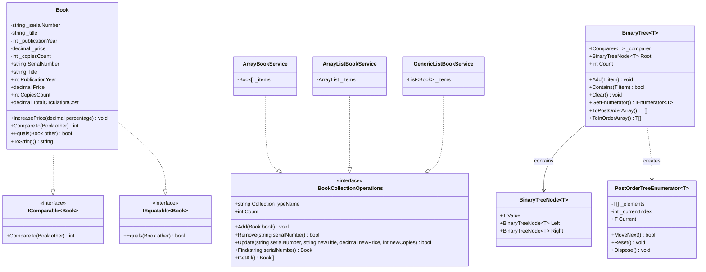

# Лабораторна робота №2 (Модуль 3, Лаб 3.2)

> **Дисципліна:** Об'єктно-орієнтоване програмування (C# / .NET 8)  
> **Тема:** Дослідження колекцій та узагальнених колекцій C#  
> **Варіант:** 2  

---

## 📋 Зміст
1. [Постановка завдання (Варіант 2)](#-постановка-завдання-варіант-2)
2. [Архітектура та структура проєкту](#-архітектура-та-структура-проєкту)
3. [Діаграма класів (Mermaid)](#-діаграма-класів-mermaid)
4. [Реалізовані концепції та компоненти](#-реалізовані-концепції-та-компоненти)
5. [Порівняльний аналіз колекцій](#-порівняльний-аналіз-колекцій)
6. [Бінарне дерево та власний ітератор](#-бінарне-дерево-та-власний-ітератор)
7. [Інструкція із запуску та тестування](#-інструкція-із-запуску-та-тестування)
8. [Відповіді на контрольні запитання (15 питань)](#-відповіді-на-контрольні-запитання-15-питань)
9. [Шпаргалка студента для успішного захисту](#-шпаргалка-студента-для-успішного-захисту)

---

## 🎯 Постановка завдання (Варіант 2)

### Параметри варіанта 2:
- **Клас предметної області:** Книга (`Book`).
- **Поля / Властивості:**
  - Серійний номер (`SerialNumber` / ISBN).
  - Назва книги (`Title`).
  - Рік видання (`PublicationYear`).
  - Вартість примірника (`Price`).
  - Кількість примірників (`CopiesCount`).
- **Методи та обчислювані властивості:**
  - Збільшення вартості на певний відсоток (`IncreasePrice(decimal percentage)`).
  - Загальна вартість тиражу (`TotalCirculationCost` = `Price * CopiesCount`).
  - Виведення інформації про книгу (`ToString()`).
- **Кількість початкових об'єктів:** 4 книги.
- **Порядок обходу дерева:** Зворотній порядок (**Postorder**: Left -> Right -> Root).

### Етапи виконання згідно з критеріями оцінювання:
1. **Оцінка «задовільно» (п. 1-2):**
   - Описати клас `Book`.
   - Створити список об’єктів класу, використовуючи:
     1. Масив (`Book[]`).
     2. Неузагальнену (non-generic) колекцію (`System.Collections.ArrayList`).
     3. Узагальнену (generic) колекцію (`System.Collections.Generic.List<Book>`).
   - Продемонструвати операції: додавання, видалення, оновлення, пошук, обхід.
   - Порівняти поведінку та пояснити відмінності (типізація, boxing/unboxing, динамічна пам'ять).
2. **Оцінка «добре» (п. 1-3):**
   - Створити узагальнене бінарне дерево пошуку `BinaryTree<T>` для збереження даних будь-якого типу.
   - Встановити обмеження узагальнення: елементами дерева **не можуть бути структури** (`where T : class`).
3. **Оцінка «відмінно» (п. 1-4):**
   - Доповнити бінарне дерево операцією порівняння через `IComparable<T>` та `IComparer<T>`.
   - Продемонструвати функціонал інтерфейсів порівняння через виклики методів сортування (`Array.Sort`, `List<T>.Sort`, деревовидне сортування).
   - Реалізувати **власний ітератор** із використанням інтерфейсів `IEnumerable`, `IEnumerator`, `IEnumerable<T>`, `IEnumerator<T>`.
   - Забезпечити обхід дерева у **зворотному порядку (postorder)** відповідно до варіанта 2.

---

## 🏛️ Архітектура та структура проєкту

Проєкт реалізовано за трирівневою модульною структурою (.NET 8):

```text
labs/Lab02/
├── Lab02.sln                       # Рішення Visual Studio / JetBrains Rider
├── README.md                       # Звіт, документація, відповіді на питання
├── src/
│   ├── Lab02.Core/                 # Бібліотека класів (доменна бізнес-логіка)
│   │   ├── Models/
│   │   │   └── Book.cs             # Клас Книга (IComparable<Book>, IEquatable<Book>)
│   │   ├── Comparers/
│   │   │   └── BookComparers.cs    # Класи IComparer<Book> (за ціною, роком, тиражем, назвою)
│   │   ├── Data/
│   │   │   └── BookDataSample.cs   # 4 початкові об'єкти згідно з варіантом 2
│   │   ├── Collections/
│   │   │   ├── IBookCollectionOperations.cs # Уніфікований інтерфейс операцій
│   │   │   ├── ArrayBookService.cs          # Реалізація на базі Book[]
│   │   │   ├── ArrayListBookService.cs      # Реалізація на базі ArrayList
│   │   │   ├── GenericListBookService.cs    # Реалізація на базі List<Book>
│   │   │   └── CollectionsComparisonManager.cs # Порівняння та зведені дані
│   │   ├── Tree/
│   │   │   ├── BinaryTreeNode.cs            # Вузол дерева (where T : class)
│   │   │   ├── PostOrderTreeEnumerator.cs   # Власний ітератор (postorder)
│   │   │   └── BinaryTree.cs                # Узагальнене дерево пошуку
│   │   └── Services/
│   │       └── BookSortingService.cs        # Демонстрація сортування через інтерфейси
│   └── Lab02.App/                  # Консольний інтерфейс користувача (CLI)
│       ├── Program.cs              # Точка входу
│       └── ConsoleMenu.cs          # Інтерактивне меню демонстрації
└── tests/
    └── Lab02.Tests/                # Модульні тести xUnit (48 тестів)
        ├── Models/
        │   └── BookTests.cs
        ├── Collections/
        │   └── CollectionsServiceTests.cs
        ├── Tree/
        │   └── BinaryTreeTests.cs
        └── Comparers/
            └── ComparersAndSortingTests.cs
```

---

## 📊 Діаграма класів (Mermaid)



---

## 💡 Реалізовані концепції та компоненти

1. **Доменна модель `Book`**:
   - Інкапсуляція з валідацією полів (рік від 1450 до поточного+1, невід'ємна ціна та тираж, непорожній ISBN і назва).
   - Обчислювана властивість `TotalCirculationCost` ($Price \times CopiesCount$).
   - Метод `IncreasePrice(decimal percentage)` для динамічного підвищення вартості.
   - Реалізація `IComparable<Book>`, `IComparable` та `IEquatable<Book>`.

2. **Порівняння об'єктів (`IComparable<T>` vs `IComparer<T>`)**:
   - `IComparable<Book>` визначає природний порядок сортування (за назвою книги).
   - Спеціалізовані класи `IComparer<Book>`:
     - `BookPriceComparer`: сортування за вартістю примірника.
     - `BookTotalCostComparer`: сортування за вартістю всього тиражу.
     - `BookYearComparer`: сортування за роком видання.
     - `BookTitleComparer`: явне сортування за назвою.

---

## ⚖️ Порівняльний аналіз колекцій

| Критерій | `Book[]` (Масив) | `ArrayList` (Non-generic) | `List<Book>` (Generic) |
| :--- | :--- | :--- | :--- |
| **Простір імен** | Вбудований тип CLR | `System.Collections` | `System.Collections.Generic` |
| **Безпека типів** | Статична на етапі компіляції | **Відсутня** (зберігає `object`), помилки під час виконання | **Повна статична типізація** на етапі компіляції |
| **Boxing / Unboxing** | Відсутнє для `Book` | Потрібне явне приведення типів `(Book)`, boxing для value types | Відсутнє взагалі, пряма робота з типом `Book` |
| **Виділення пам'яті** | Фіксована неперервна область | Внутрішній масив `object[]`, подвоєння розміру | Внутрішній типізований `Book[]`, подвоєння розміру |
| **Зміна розміру** | Тільки ручне виділення (`Array.Copy`) | Автоматичне при вичерпанні ємності (`Capacity`) | Автоматичне при вичерпанні ємності (`Capacity`) |
| **Швидкодія** | Найвища (без накладних витрат) | Найнижча (приведення типів, зайві перевірки) | Висока (JIT генерує спеціалізований машинний код) |

---

## 🌲 Бінарне дерево та власний ітератор

### Обмеження узагальнення:
```csharp
public class BinaryTree<T> : IEnumerable<T> where T : class
```
Вимога лабораторної роботи забороняє елементам дерева бути структурами. Обмеження `where T : class` гарантує, що `T` є виключно посилальним типом.

### Зворотній порядок обходу (Postorder Traversal):
Згідно з Варіантом 2 обхід виконується за алгоритмом:
$$\text{Ліве піддерево} \rightarrow \text{Праве піддерево} \rightarrow \text{Поточний вузол (корінь)}$$

### Власний ітератор `PostOrderTreeEnumerator<T>`:
Ітератор реалізує інтерфейси:
- `IEnumerator<T>` (типізований доступ через `Current`).
- `System.Collections.IEnumerator` (неузагальнений доступ для сумісності).
- `IDisposable`.

Реалізовано методи:
- `bool MoveNext()`: переміщення до наступного елемента в послідовності postorder.
- `T Current`: повернення поточного елемента з контролем меж діапазону.
- `void Reset()`: скидання позиції до початку.

---

## 🚀 Інструкція із запуску та тестування

### Збірка рішення:
```bash
dotnet build labs/Lab02/Lab02.sln
```

### Запуск консольного застосунку:
```bash
dotnet run --project labs/Lab02/src/Lab02.App/Lab02.App.csproj
```

### Запуск модульних тестів (48 тестів xUnit):
```bash
dotnet test labs/Lab02/Lab02.sln
```

---

## ❓ Відповіді на контрольні запитання (15 питань)

### 1. Дайте визначення колекції. Наведіть типи колекцій FCL.
**Колекція** — це структура даних, що об'єднує групу об'єктів в єдине ціле і надає засоби для додавання, видалення, пошуку, сортування та перебору елементів.
У бібліотеці базових класів .NET (FCL) виділяють 4 основні категорії колекцій:
1. **Неузагальнені (Non-generic, `System.Collections`)**: `ArrayList`, `Hashtable`, `Queue`, `Stack`.
2. **Узагальнені (Generic, `System.Collections.Generic`)**: `List<T>`, `Dictionary<TKey, TValue>`, `HashSet<T>`, `Queue<T>`, `Stack<T>`, `LinkedList<T>`.
3. **Спеціалізовані (`System.Collections.Specialized`)**: `StringCollection`, `HybridDictionary`, `NameValueCollection`.
4. **Потокобезпечні / конкурентні (`System.Collections.Concurrent`)**: `ConcurrentDictionary<TKey, TValue>`, `ConcurrentQueue<T>`, `BlockingCollection<T>`.

### 2. Що таке операції «упаковка» і «розпаковка»? Наведіть приклади.
- **Упаковка (Boxing)** — неявне перетворення змінної типу значення (value type, наприклад `int`, `double`, `struct`) у тип `object` або інтерфейс. При цьому в купі (managed heap) виділяється новий об'єкт, куди копіюється значення зі стеку.
  ```csharp
  int number = 42;
  object boxed = number; // Boxing: виділення пам'яті в купі
  ```
- **Розпаковка (Unboxing)** — явне перетворення об'єкта типу `object` назад у вихідний тип значення. Вимагає зчитування адреси та копіювання даних із купи назад у стек.
  ```csharp
  int unboxed = (int)boxed; // Unboxing: явне приведення
  ```
Упаковка суттєво знижує швидкодію та створює додаткове навантаження на Garbage Collector.

### 3. Наведіть основні інтерфейси, які успадковуються колекціями, та їх призначення.
- `IEnumerable` / `IEnumerable<T>`: базові інтерфейси, які дозволяють перебирати колекцію через цикл `foreach` за допомогою `GetEnumerator()`.
- `IEnumerator` / `IEnumerator<T>`: безпосередньо ітератор (`MoveNext()`, `Current`, `Reset()`).
- `ICollection` / `ICollection<T>`: розширює перебір властивостями `Count`, методами `Add()`, `Remove()`, `Clear()`, `Contains()`, `CopyTo()`.
- `IList` / `IList<T>`: колекція з індексованим доступом (`this[int index]`, `Insert()`, `RemoveAt()`).
- `IDictionary<TKey, TValue>`: асоціативні масиви типу «ключ-значення» (`Keys`, `Values`, `ContainsKey()`, `TryGetValue()`).
- `ISet<T>`: множини унікальних елементів (`UnionWith`, `IntersectWith`).

### 4. Наведіть класи колекцій, які реалізують типову поведінку основних структур даних.
- **Динамічний масив (Список):** `List<T>`, `ArrayList`.
- **Зв'язний список (Linked List):** `LinkedList<T>` (двозв'язний список).
- **Хеш-таблиця (Асоціативний масив):** `Dictionary<TKey, TValue>`, `Hashtable`.
- **Черга (FIFO - First-In-First-Out):** `Queue<T>`, `Queue`.
- **Стек (LIFO - Last-In-First-Out):** `Stack<T>`, `Stack`.
- **Множина (Set):** `HashSet<T>`, `SortedSet<T>`.

### 5. Поясніть призначення нумератору (ітератору) колекцій.
**Нумератор (ітератор)** реалізує патерн проєктування *Iterator*. Його призначення — надати послідовний доступ до елементів складеного об'єкта без розкриття його внутрішнього устрою (масив, зв'язний список, бінарне дерево, хеш-таблиця). Він інкапсулює стан поточного положення під час обходу.

### 6. Як реалізувати власний нумератор (ітератор)? В яких випадках він потрібний?
Реалізувати ітератор можна двома шляхами:
1. **Створення окремого класу**, який реалізує `IEnumerator<T>` (та `IEnumerator`, `IDisposable`), реалізувавши методи `MoveNext()`, `Current`, `Reset()`, `Dispose()`. Цей підхід застосовано в нашій лабораторній роботі в класі `PostOrderTreeEnumerator<T>`.
2. **Використання ітераторного блоку з ключовим словом `yield return`** у методі, що повертає `IEnumerable<T>` або `IEnumerator<T>`. Компілятор C# самостійно згенерує внутрішній кінцевий автомат (state machine).

Власний нумератор потрібний, коли колекція має нестандартну топологію (наприклад, деревоподібна структура з різними порядками обходу — preorder, inorder, postorder) або коли необхідно реалізувати ліниві обчислення (lazy evaluation).

### 7. Дані якого формату зберігаються у хеш-таблиці?
У хеш-таблиці (`Hashtable`, `Dictionary<TKey, TValue>`) дані зберігаються у вигляді пар **«ключ — значення» (Key-Value Pair)**. Для кожного ключа обчислюється хеш-код (`GetHashCode()`), який визначає індекс комірки (bucket) для швидкого доступу зі складністю $O(1)$.

### 8. Поясніть особливості узагальнених типів .Net.
Узагальнення (Generics) у .NET параметризують типи, методи та інтерфейси без прив'язки до конкретного типу даних на етапі написання коду.
**Особливості:**
- **Безпека типів:** перевірка коректності типів здійснюється на етапі компіляції.
- **Відсутність boxing/unboxing:** значущі типи не пакуються в об'єкт.
- **Ефективність пам'яті та швидкодія:** JIT-компілятор генерує оптимізований машинний код окремо для кожного значущого типу та єдиний спільний екземпляр для всіх посилальних типів.

### 9. Поясніть сутність обмежень узагальнених типів.
Обмеження (Generic Constraints) накладаються за допомогою ключового слова `where T : ...`. Вони звужують набір типів, якими можна типізувати узагальнення, і дозволяють звертатися до членів гарантованих інтерфейсів чи базових класів.
**Основні види обмежень:**
- `where T : class` — тип має бути посилальним (як у нашому `BinaryTree<T>`).
- `where T : struct` — тип має бути типом значення.
- `where T : notnull` — ненульовий тип.
- `where T : new()` — тип повинен мати публічний конструктор без параметрів.
- `where T : BaseClass` — спадкоємець конкретного класу.
- `where T : IComparable<T>` — повинен реалізовувати інтерфейс.

### 10. Що може бути реалізовано як узагальнення в C#?
В C# узагальненими можуть бути:
1. Класи (`class BinaryTree<T>`).
2. Структури (`struct Nullable<T>`).
3. Інтерфейси (`interface IComparable<T>`).
4. Делегати (`delegate void Action<in T>(T obj)`, `Func<out TResult>`).
5. Методи (як всередині узагальнених, так і в звичайних класах).
6. Записи (`record Pair<T1, T2>(T1 First, T2 Second)`).

### 11. Порівняйте універсальні, узагальнені колекції та масиви.
- **Масиви (`T[]`):** мають найвищу швидкодію, фіксовану довжину, статичну типізацію, прямий доступ за індексом, але не підтримують динамічне додавання елементів.
- **Універсальні (неузагальнені, `ArrayList`):** динамічні за розміром, але позбавлені безпеки типів (зберігають `object`), що спричиняє накладні витрати на упаковку/розпаковку і ризик `InvalidCastException`.
- **Узагальнені (`List<T>`):** поєднують динамічність розміру, безпеку типів та найвищу продуктивність без операцій приведення типів.

### 12. Коли варто створювати власні класи колекцій?
Створювати власні класи колекцій варто у випадках:
- Необхідна специфічна внутрішня структура даних (бінарне дерево пошуку, префіксне дерево Trie, граф, циклічний буфер).
- Потрібно інкапсулювати спеціальні бізнес-правила (валідація при вставці, обмеження місткості, обчислення додаткової статистики).
- Необхідно надати нестандартні способи ітерації або особливу логіку балансування даних.

### 13. В чому різниця між інтерфейсами IComparer та IComparable? Для чого вони призначені?
- **`IComparable`**: реалізується **самим об'єктом**, який порівнюється (метод `CompareTo(object obj)`). Визначає природний, внутрішній порядок порівняння об'єкта за замовчуванням ("я вмію порівнювати себе з іншим").
- **`IComparer`**: реалізується **окремим допоміжним класом-компаратором** (метод `Compare(object x, object y)`). Дозволяє реалізувати множинні альтернативні критерії порівняння (наприклад, окремо за ціною, за роком, за тиражем).

### 14. В чому різниця між універсальними інтерфейсами IComparer, IComparable та узагальненими IComparer<T>, IComparable<T>?
- **Універсальні (`IComparable`, `IComparer`):** оперують аргументами типу `object`. Вимагають перевірки типів і приведення `(Book)obj`, що призводить до упаковки (boxing) для значущих типів і потенційних помилок у рантаймі.
- **Узагальнені (`IComparable<T>`, `IComparer<T>`):** строго типізовані на етапі компіляції (`CompareTo(T other)`, `Compare(T x, T y)`). Забезпечують повну безпеку типів, відсутність boxing/unboxing та максимальну швидкодію.

### 15. Для чого призначені інтерфейси IEnumerable, IEnumerator та IEnumerable<T>, IEnumerator<T>?
- `IEnumerable` / `IEnumerable<T>` позначають клас як такий, що **може бути перебраний** (перелічуваний), повертаючи об'єкт-ітератор методом `GetEnumerator()`. Вони є контрактом для роботи циклу `foreach` та операторів LINQ.
- `IEnumerator` / `IEnumerator<T>` — це безпосередньо сам **об'єкт-ітератор**, який виконує прохід елементами через метод `MoveNext()`, повертає поточний елемент через `Current` та скидає стан через `Reset()`. Узагальнені версії забезпечують сувору типізацію повернених елементів без приведення до `object`.

---

## 🎓 Шпаргалка студента для успішного захисту

| Питання викладача | Коротке, впевнене формулювання відповіді |
| :--- | :--- |
| **Який у вас варіант і клас?** | Варіант 2: клас `Book` (Книга: серійний номер, назва, рік видання, вартість, кількість примірників). Збільшення вартості на процент, вартість тиражу, 4 об'єкти, зворотній обхід (postorder). |
| **Чому для дерева використано `where T : class`?** | За ТЗ елементами дерева не можуть бути структури. Обмеження `where T : class` забороняє value types і гарантує роботу виключно з посилальними типами. |
| **Що таке Postorder обхід?** | Зворотній обхід бінарного дерева: спочатку рекурсивно обходиться ліве піддерево, потім праве піддерево, і в кінці — сам поточний вузол (Left -> Right -> Root). |
| **Як реалізовано власний ітератор?** | Створено окремий клас `PostOrderTreeEnumerator<T>`, який реалізує `IEnumerator<T>`, `IEnumerator` та `IDisposable` без використання автогенерації `yield return`. |
| **Різниця між `IComparable<T>` та `IComparer<T>`?** | `IComparable<T>` вбудовано в сам клас `Book` для сортування за замовчуванням (за назвою). `IComparer<T>` винесено в окремі класи (`BookPriceComparer`, `BookYearComparer`) для сортування за альтернативними критеріями. |
| **У чому перевага `List<T>` над `ArrayList`?** | `List<T>` узагальнений: гарантує безпеку типів на етапі компіляції, не потребує приведення `(Book)` та не створює операцій boxing/unboxing. |
