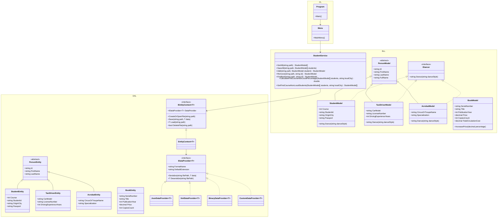

# Лабораторна робота №3 (Модуль 3, Лаб 3.3)

> **Дисципліна:** Об'єктно-орієнтоване програмування (C# / .NET 8)  
> **Тема:** Дослідження механізму серіалізації та типової трирівневої архітектури застосування  
> **Варіант:** 2  

---

## 📋 Зміст
1. [Постановка завдання (Варіант 2)](#-постановка-завдання-варіант-2)
2. [Архітектура проєкту та трирівнева модель](#-архітектура-проєкту-та-трирівнева-модель)
3. [Діаграма класів (Mermaid)](#-діаграма-класів-mermaid)
4. [Дослідження серіалізації (Частина 1)](#-дослідження-серіалізації-частина-1)
5. [Реалізація трирівневої архітектури (Частина 2)](#-реалізація-трирівневої-архітектури-частина-2)
6. [Індивідуальне завдання (Варіант 2)](#-індивідуальне-завдання-варіант-2)
7. [Інструкція із запуску та тестування](#-інструкція-із-запуску-та-тестування)
8. [Відповіді на контрольні запитання (15 питань)](#-відповіді-на-контрольні-запитання-15-питань)

---

## 🎯 Постановка завдання (Варіант 2)

### Частина 1. Дослідження механізму серіалізації
- **Клас предметної області:** `Book` (Книга).
- **Поля / Властивості:**
  - `SerialNumber` (серійний номер / ISBN).
  - `Title` (назва).
  - `PublicationYear` (рік видання).
  - `Price` (вартість примірника).
  - `CopiesCount` (кількість примірників).
- **Методи та обчислювані властивості:**
  - `IncreasePrice(decimal percentage)` — збільшення вартості на певний відсоток.
  - `TotalCirculationCost` — загальна вартість тиражу (`Price * CopiesCount`).
  - `ToString()` — форматоване виведення інформації.
- **Кількість початкових об'єктів:** 4 книги.
- **Вимоги:**
  - Серіалізація та десеріалізація масиву `Book[]`.
  - Серіалізація та десеріалізація колекції `List<Book>`.
  - Порівняння 4 механізмів: Binary, XML, JSON та Custom (власна токенізована).

### Частина 2. Трирівнева архітектура (DAL / BLL / PL)
- **Рівні рішення (3 окремі проєкти):**
  1. `Lab03.DAL` — рівень доступу до даних. Містить виключно сутності сховища (`PersonEntity`, `StudentEntity`, `TaxiDriverEntity`, `AcrobatEntity`, `BookEntity`), абстракцію `IDataProvider<T>` з чотирма реалізаціями та контекст даних `EntityContext<T>`.
  2. `Lab03.BLL` — рівень бізнес-логіки. Містить власні моделі (`StudentModel`, `TaxiDriverModel`, `AcrobatModel`, `BookModel`), мапери, сервіси (`StudentService`, `TaxiDriverService`, `AcrobatService`, `SerializationComparisonService`), валідацію та доменні винятки (`DomainException`, `ValidationException`, `EntityNotFoundException`, `DuplicateEntityException`, `StorageException`). Не використовує `Console` та `Stream`.
  3. `Lab03.PL` — рівень представлення (консольний CLI). `Program.Main()` викликає лише `Menu.MainMenu()`. Меню забезпечує взаємодію з користувачем, вибір провайдера та шляху файлу, перехоплення та відображення винятків.
- **Основна сутність:** `Student`:
  - `LastName`, `FirstName`, `Course`, `StudentId`, `OriginCity`, `Passport`.
- **Операції:**
  - Обчислити відсоток студентів 1-го курсу, які приїхали з інших міст (`CalculateFirstCourseNonLocalPercentage`).
  - Отримати список відповідних студентів із файлу (`GetFirstCourseNonLocalStudents`).
- **Додаткові сутності:**
  - `TaxiDriver` (`CarModel`, `LicenseNumber`, `DrivingExperienceYears`).
  - `Acrobat` (`CircusOrTroupeName`, `Specialization`).
- **Додаткове вміння (поліморфізм через спільний інтерфейс):**
  - Інтерфейс `IDancer` з методом `string Dance(string danceStyle = "Вальс")`, реалізований класами `StudentModel`, `TaxiDriverModel`, `AcrobatModel`.

---

## 🏛 Архітектура проєкту та трирівнева модель

```text
labs/Lab03/
├── Lab03.sln
├── src/
│   ├── Lab03.DAL/                          # Рівень доступу до даних (DAL)
│   │   ├── Entities/                       # DAL-сутності (тільки дані)
│   │   │   ├── PersonEntity.cs
│   │   │   ├── StudentEntity.cs
│   │   │   ├── TaxiDriverEntity.cs
│   │   │   ├── AcrobatEntity.cs
│   │   │   └── BookEntity.cs
│   │   ├── Providers/                      # Провайдери серіалізації
│   │   │   ├── IDataProvider.cs
│   │   │   ├── JsonDataProvider.cs
│   │   │   ├── XmlDataProvider.cs
│   │   │   ├── BinaryDataProvider.cs
│   │   │   └── CustomDataProvider.cs
│   │   └── Context/                        # Фізичний доступ до файлів
│   │       ├── IEntityContext.cs
│   │       └── EntityContext.cs
│   ├── Lab03.BLL/                          # Рівень бізнес-логіки (BLL)
│   │   ├── Interfaces/                     # Поведінкові інтерфейси (IDancer)
│   │   ├── Models/                         # Доменні моделі та DTO
│   │   │   ├── PersonModel.cs
│   │   │   ├── StudentModel.cs
│   │   │   ├── TaxiDriverModel.cs
│   │   │   ├── AcrobatModel.cs
│   │   │   ├── BookModel.cs
│   │   │   └── SerializationExperimentResult.cs
│   │   ├── Exceptions/                     # Власна ієрархія винятків
│   │   │   ├── DomainException.cs
│   │   │   ├── ValidationException.cs
│   │   │   ├── EntityNotFoundException.cs
│   │   │   ├── DuplicateEntityException.cs
│   │   │   └── StorageException.cs
│   │   ├── Mappers/                        # Ізоляція шарів (Entity <-> Model)
│   │   │   ├── StudentMapper.cs
│   │   │   ├── TaxiDriverMapper.cs
│   │   │   ├── AcrobatMapper.cs
│   │   │   └── BookMapper.cs
│   │   └── Services/                       # Бізнес-сервіси без Console/Stream
│   │       ├── StudentService.cs
│   │       ├── TaxiDriverService.cs
│   │       ├── AcrobatService.cs
│   │       └── SerializationComparisonService.cs
│   └── Lab03.PL/                           # Рівень представлення (PL)
│       ├── Program.cs                      # Main() -> Menu.MainMenu()
│       └── Menu.cs                         # Консольний інтерфейс
└── tests/
    └── Lab03.Tests/                        # xUnit тести для всіх рівнів
        ├── DAL/
        │   ├── SerializationTests.cs
        │   └── EntityContextTests.cs
        └── BLL/
            ├── StudentServiceTests.cs
            ├── BookModelTests.cs
            ├── ValidationAndPolymorphismTests.cs
            ├── MappersTests.cs
            └── SerializationComparisonServiceTests.cs
```

---

## 📊 Діаграма класів (Mermaid)



---

## 🔬 Дослідження серіалізації (Частина 1)

У проєкті реалізовано порівняльне дослідження серіалізації 4 книг (`Book`) у вигляді звичайного масиву `Book[]` та узагальненої колекції `List<Book>` для чотирьох провайдерів:

| Провайдер | Тип контейнера | Розмір файлу | Час сер-ї | Час десер-ї | Людиночитабельність | Безпека та типобезпека |
|:---|:---|:---:|:---:|:---:|:---:|:---:|
| **Binary** | `Book[]` / `List<Book>` | ~160 байт | < 0.2 мс | < 0.1 мс | Ні (бінарний потік) | Висока (типізований `BinaryWriter/Reader`) |
| **JSON** | `Book[]` / `List<Book>` | ~550 байт | < 0.5 мс | < 0.4 мс | Так (структурований текст) | Висока (Web-стандарт, захист від ін'єкцій) |
| **Custom** | `Book[]` / `List<Book>` | ~620 байт | < 0.4 мс | < 0.3 мс | Так (формат за методичкою НАУ) | Висока (контрольований парсер) |
| **XML** | `Book[]` / `List<Book>` | ~980 байт | < 1.0 мс | < 0.8 мс | Так (теги з метаданими) | Середня (надлишковий синтаксис) |

### Висновки щодо серіалізації:
1. **BinaryDataProvider** забезпечує найменший розмір файлу та найвищу швидкість, оскільки записує байти напряму без форматування рядків.
2. **JsonDataProvider** (`System.Text.Json`) є оптимальним за співвідношенням швидкості, компактності та сумісності з сучасними веб-інтерфейсами.
3. **XmlDataProvider** генерує найбільший розмір файлу через накладні витрати на закриваючі теги, але забезпечує жорстку валідацію за XSD-схемою.
4. **CustomDataProvider** демонструє відповідність формату:
   ```text
   Book 978-0132350884
   {
     "SerialNumber": "978-0132350884",
     "Title": "Clean Code",
     "PublicationYear": "2008",
     "Price": "450.00",
     "CopiesCount": "1500"
   };
   ```

---

## 🎯 Індивідуальне завдання (Варіант 2)

**Постановка:**  
> *«Обчислити відсоток студентів 1-го курсу, які приїхали з інших міст. Отримати їх дані з файлу.»*

### Реалізований алгоритм у `StudentService`:
$$\text{Percentage} = \frac{N_{\text{1-й курс, не з базового міста}}}{N_{\text{1-й курс, всього}}} \times 100\%$$

- Якщо кількість студентів 1-го курсу дорівнює нулю, метод повертає `0.0%`, унеможливлюючи ділення на нуль (`DivideByZeroException`).
- Результат округлюється до 2 знаків після коми.

---

## 🚀 Інструкція із запуску та тестування

### 1. Збірка проєкту:
```bash
dotnet build labs/Lab03/Lab03.sln --configuration Release
```

### 2. Запуск консольного застосунку:
```bash
dotnet run --project labs/Lab03/src/Lab03.PL/Lab03.PL.csproj
```

### 3. Запуск усіх модульних тестів:
```bash
dotnet test labs/Lab03/Lab03.sln
```

---

## ❓ Відповіді на контрольні запитання (15 питань)

### 1. Розкрийте сутність та призначення механізму серіалізації.
**Серіалізація** — це процес перетворення стану об'єкта (його полів та властивостей) у послідовність байтів або текстовий формат (JSON, XML, Custom) для збереження у пам'яті, файлі чи базі даних, а також для передачі через комп'ютерну мережу.  
**Десеріалізація** — це зворотний процес відновлення об'єкта в оперативній пам'яті з цього потоку. Мета: тривале зберігання стану (persistence) та міжпроцесна комунікація.

### 2. Яка альтернатива серіалізації існує в мові C++?
У мові C++ відсутня вбудована рефлексія на рівні середовища виконання, тому стандартними альтернативами є:
- Перевантаження операторів потокового вводу/виводу `operator<<` та `operator>>` для `std::ostream` / `std::istream`.
- Прямий бінарний запис пам'яті через `std::ostream::write(reinterpret_cast<char*>(&obj), sizeof(obj))` (для POD/trivially copyable типів).
- Сторонні бібліотеки рефлексії та серіалізації: Boost.Serialization, Google Protocol Buffers (Protobuf), FlatBuffers, Cereal, nlohmann/json.

### 3. Які типи серіалізації існують в C#?
1. **Бінарна (Binary)**: збереження внутрішнього двійкового представлення даних (швидка, компактна).
2. **Текстова XML-серіалізація** (`System.Xml.Serialization.XmlSerializer`): збереження у теговому форматі XML.
3. **Текстова JSON-серіалізація** (`System.Text.Json` або `Newtonsoft.Json`): легковаговий текстовий формат ключ-значення.
4. **Користувацька (Custom)**: власна логіка парсингу та форматування (через `ISerializable`, `BinaryReader/Writer` або токенізовані текстові парсери).

### 4. Опишіть механізм стандартної серіалізації.
Стандартна декларативна серіалізація в класичному .NET реалізовувалася за допомогою атрибута `[Serializable]` та форматерів. Форматер через рефлексію обходив граф об'єктів, зчитував значення всіх відкритих і закритих полів (якщо вони не позначені `[NonSerialized]`) і записував їх метадані разом зі значеннями в цільовий потік.

### 5. Опишіть механізм бінарної серіалізації.
Бінарна серіалізація записує типи даних і їхні значення у вигляді компактних байтових блоків без текстових розділювачів.  
*Примітка щодо .NET 8+:* Старий клас `BinaryFormatter` визнано небезпечним (vulnerable to RCE) і відключено за замовчуванням. Сучасна безпечна бінарна серіалізація реалізується за допомогою `BinaryWriter`/`BinaryReader`, де кожне поле записується строго типізовано з підтримкою сигнатури формату (Magic Number).

### 6. Опишіть механізм користувацької серіалізації.
Користувацька серіалізація дозволяє розробнику повністю контролювати процес запису та відновлення стану об'єкта. У класичному підході це реалізується через інтерфейс `ISerializable` та спеціальний конструктор десеріалізації `(SerializationInfo info, StreamingContext context)`. У сучасних архітектурах користувацька серіалізація втілюється через окремі класи-провайдери (`CustomDataProvider`), які самостійно транслюють поля об'єкта в заданий формат (наприклад, токенізований текст).

### 7. Опишіть механізм XML серіалізації.
`System.Xml.Serialization.XmlSerializer` серіалізує **тільки відкриті (public) поля та властивості**, які мають `get` і `set`. Клас обов'язково повинен мати відкритий конструктор без параметрів. За допомогою атрибутів (`[XmlElement]`, `[XmlAttribute]`, `[XmlIgnore]`, `[XmlInclude]`) можна керувати структурою результуючого XML-документа.

### 8. Опишіть механізм JSON серіалізації.
Реалізується простором імен `System.Text.Json` (`JsonSerializer`). Об'єкт перетворюється на рядок формату JavaScript Object Notation. Серіалізатор працює на базі `Utf8JsonWriter`/`Utf8JsonReader`, що забезпечує мінімальні алокації пам'яті (використання `Span<byte>`). Підтримує налаштування відступів (`WriteIndented`), ігнорування `null`-значень та мапінг назв властивостей.

### 9. В чому полягає концепція багаторівневої архітектури застосування? Для чого вона потрібна?
Концепція полягає у розподілі обов'язків (Separation of Concerns) на незалежні рівні/шари (Layers). Основні рівні:
1. **DAL (Data Access Layer)** — фізична робота зі сховищем (файли, БД).
2. **BLL (Business Logic Layer)** — бізнес-правила, розрахунки, валідація даних.
3. **PL (Presentation Layer)** — інтерфейс користувача (консоль, веб, GUI).
Призначення: спрощення тестування (unit testing), масштабованість, повторне використання коду, можливість заміни сховища або інтерфейсу без зміни бізнес-логіки.

### 10. Які існують рівні і як вони зв’язані між собою?
Рівні зв'язані за принципом односпрямованої залежності зверху вниз:
- `PL` знає про `BLL` і викликає його методи.
- `BLL` знає про `DAL` (контракти/контексти) і отримує дані.
- `DAL` не знає ні про `BLL`, ні про `PL`.
Зв'язок реалізується через інтерфейси (`IDataProvider`, `IEntityContext`) та впровадження залежностей (Dependency Injection / IoC).

### 11. Чому необхідно ізолювати рівні чи окремий функціонал?
Ізоляція зменшує зв'язність (Coupling) і збільшує згуртованість (Cohesion):
- Зміни у способі зберігання даних (наприклад, перехід з JSON на базу даних SQL) не впливають на BLL і PL.
- Зміна інтерфейсу користувача (з консолі на Web API) не вимагає переписування бізнес-логіки.
- Дозволяє писати незалежні модульні тести з моками або фейками.

### 12. Як розподіляються класи між окремими рівнями та проєктами в рішенні?
- **DAL-проєкт:** `*Entity` (сутності без логіки), класи-провайдери (`*DataProvider`), контексти (`*Context`), репозиторії.
- **BLL-проєкт:** доменні моделі (`*Model`), інтерфейси поведінки (`IDancer`), бізнес-сервіси (`*Service`), класи валідації, доменні винятки (`*Exception`), мапери (`*Mapper`).
- **PL-проєкт:** класи консольного меню (`Menu`), контролери, форматери вводу/виводу, точка входу (`Program.Main`).

### 13. Яким чином допомагає абстракція при проектуванні багаторівневої архітектури?
Абстракція (інтерфейси `IDataProvider<T>`, `IEntityContext<T>`, `IDancer`) дозволяє зафіксувати контракти взаємодії між рівнями без прив'язки до деталей реалізації (принцип Inversion of Dependency з SOLID). Вищий рівень працює з інтерфейсом, а конкретна реалізація підставляється динамічно.

### 14. Чим можуть бути корисні узагальнення та колекції при серіалізації та проектуванні багаторівневої архітектури?
Узагальнення (Generics `T`) дозволяють написати єдиний універсальний механізм контексту (`EntityContext<T>`) або провайдера (`JsonDataProvider<T>`), який без дублювання коду серіалізує будь-які типи (`StudentEntity[]`, `TaxiDriverEntity[]`, `BookEntity[]`). Це забезпечує типізацію під час компіляції та усуває накладні витрати на упаковку/розпаковку (boxing/unboxing).

### 15. Чому необхідно, щоб метод виконував тільки одну задачу?
Метод повинен відповідати **Single Responsibility Principle (SRP)**:
- Метод легко тестувати: один вхід -> один передбачуваний вихід.
- Знижується ймовірність побічних ефектів (Side Effects).
- Полегшується читання та повторне використання (Reusability).
- Спрощується пошук та усунення дефектів (Debugging).
