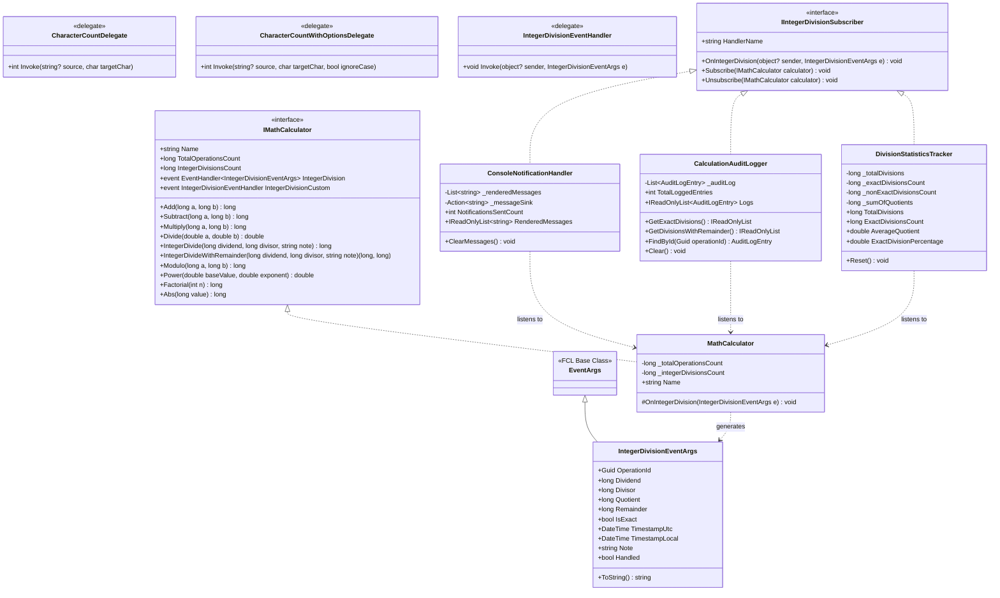

# Лабораторна робота №4 (Модуль 3, Лаб 3.4)

> **Дисципліна:** Об'єктно-орієнтоване програмування (C# / .NET 8)  
> **Тема:** Створення та використання делегатів, подій та лямбда-виразів  
> **Варіант:** 2  

---

## 📋 Зміст
1. [Постановка завдання (Варіант 2)](#-постановка-завдання-варіант-2)
2. [Архітектура та структура проєкту](#-архітектура-та-структура-проєкту)
3. [Діаграма класів (Mermaid)](#-діаграма-класів-mermaid)
4. [Реалізація Частини 1: Делегати та підрахунок входжень символу](#-реалізація-частини-1-делегати-та-підрахунок-входжень-символу)
5. [Реалізація Частини 2 & 3: Математичний компонент та подія цілочисельного ділення](#-реалізація-частини-2--3-математичний-компонент-та-подія-цілочисельного-ділення)
6. [Мультикаст-делегати та класи-підписники](#-мультикаст-делегати-та-класи-підписники)
7. [Інструкція із запуску та тестування](#-інструкція-із-запуску-та-тестування)
8. [Відповіді на контрольні запитання (13 питань)](#-відповіді-на-контрольні-запитання)
9. [Шпаргалка студента для захисту на оцінку «Відмінно»](#-шпаргалка-студента-для-захисту-на-оцінку-відмінно)

---

## 🎯 Постановка завдання (Варіант 2)

### Мета роботи
Дослідити механізм обробки подій у мові C#, навчитися проектувати, створювати та ефективно використовувати делегати, анонімні методи, лямбда-вирази та події згідно з сучасними інженерними конвенціями платформи .NET 8.

### Завдання за Варіантом 2:
1. **Частина 1 (Делегати та лямбда-вирази):**
   - Описати на мові C# лямбда-вираз та анонімний метод відповідно до варіанту: **«Пошук у рядку кількості використань заданого символу»**.
   - Викликати алгоритм через делегат із відповідним підписом.
   - *Вимога на оцінку «добре» / «відмінно»:* реалізувати як анонімний метод (`delegate (...) { ... }`), так і лямбда-вираз (`(...) => ...`), а також іменований метод та системний узагальнений делегат `Func<string, char, int>`.
2. **Частина 2 (Компонент багаторазового використання):**
   - Створити клас математичних операцій: **«Математичні операції: додавання, віднімання, множення чисел та ін. операції над значеннями»**.
   - Компонент містить член-подію: **«Цілочисельне ділення»**.
   - Створити окремий клас-аргумент події (`IntegerDivisionEventArgs`), успадкований від `System.EventArgs`.
   - Описати подію як через новий кастомний делегат (`IntegerDivisionEventHandler`), так і через стандартний generic делегат `EventHandler<IntegerDivisionEventArgs>`.
   - Забезпечити захищений віртуальний метод генерації події (`OnIntegerDivision`).
3. **Частина 3 (Додаток та класи-обробники події):**
   - Створити додаток, у якому визначити метод (-и) обробники події для компонента.
   - Забезпечити виконання вимог на оцінку «відмінно»:
     1. Наявність класу-аргументу події (`IntegerDivisionEventArgs`).
     2. Наявність класу-ініціатора (`MathCalculator`), у якому знаходяться сама подія та метод її генерації.
     3. Наявність кількох незалежних класів-підписників (`ConsoleNotificationHandler`, `CalculationAuditLogger`, `DivisionStatisticsTracker`).
     4. Методи-обробники події обов'язково мають стандартну сигнатуру .NET: `void Handler(object? sender, IntegerDivisionEventArgs e)`.
     5. Демонстрація мультикаст-делегата: підписка (`+=`) та відписка (`-=`).

---

## 🏛️ Архітектура та структура проєкту

Проєкт спроєктовано за модульною багаторівневою архітектурою з ізоляцією відповідальностей:

```text
labs/Lab04/
├── Lab04.sln                       # Файл рішення Visual Studio / JetBrains Rider / .NET CLI
├── README.md                       # Звіт лабораторної роботи та відповіді на контрольні питання
├── src/
│   ├── Lab04.Core/                 # Бібліотека класів (доменна логіка, без прив'язки до консолі)
│   │   ├── Delegates/
│   │   │   ├── CharacterCountDelegates.cs # Користувацькі делегати (CharacterCountDelegate, GenericSearchDelegate)
│   │   │   └── CharacterCounter.cs        # Реалізація пошуку (іменований, анонімний, лямбда, Func)
│   │   ├── Math/
│   │   │   ├── IntegerDivisionEventArgs.cs# Клас-аргумент події (успадкований від EventArgs)
│   │   │   ├── IntegerDivisionDelegates.cs# Кастомний делегат події (IntegerDivisionEventHandler)
│   │   │   ├── IMathCalculator.cs         # Контракт інтерфейсу математичних операцій
│   │   │   └── MathCalculator.cs          # Компонент-ініціатор з подією IntegerDivision
│   │   ├── Handlers/
│   │   │   ├── IIntegerDivisionSubscriber.cs # Інтерфейс підписників події
│   │   │   ├── ConsoleNotificationHandler.cs # Форматування сповіщень для користувача
│   │   │   ├── CalculationAuditLogger.cs     # Журналювання та фільтрація історії операцій
│   │   │   └── DivisionStatisticsTracker.cs  # Акумуляція аналітичної статистики (частки, остачі)
│   │   └── Analysis/
│   │       └── StringAnalysisResult.cs    # DTO результатів порівняння делегатів
│   └── Lab04.App/                  # Консольний інтерфейс користувача (CLI)
│       ├── Program.cs              # Точка входу
│       └── ConsoleMenu.cs          # Інтерактивне меню з покроковою демонстрацією
└── tests/
    └── Lab04.Tests/                # Набір модульних тестів xUnit (80 тестів)
        ├── Delegates/
        │   └── CharacterCounterTests.cs   # Тести іменованих методів, анонімних методів, лямбд
        ├── Math/
        │   └── MathCalculatorTests.cs     # Тести арифметичних операцій, граничних умов
        ├── Events/
        │   └── IntegerDivisionEventTests.cs# Тести генерування події та передачі аргументів
        └── Handlers/
            ├── SubscribersTests.cs        # Тести підписників, фільтрації, статистики
            └── AdvancedMulticastTests.cs  # Тести мультикаст-делегатів, GetInvocationList, unsubscription
```

---

## 📊 Діаграма класів (Mermaid)



---

## 🔍 Реалізація Частини 1: Делегати та підрахунок входжень символу

Згідно з Варіантом 2 розроблено алгоритм пошуку кількості входжень заданого символу у вхідний рядок, викликаний 4 різними способами:

1. **Користувацький іменований делегат:**
   ```csharp
   public delegate int CharacterCountDelegate(string? source, char targetChar);
   public delegate int CharacterCountWithOptionsDelegate(string? source, char targetChar, bool ignoreCase);
   ```

2. **Іменований метод (Named Method):**
   ```csharp
   public static int CountOccurrencesNamed(string? source, char targetChar) { ... }
   ```

3. **Анонімний метод (Anonymous Method — синтаксис C# 2.0 `delegate`):**
   ```csharp
   CharacterCountDelegate anonymousCounter = delegate (string? text, char target)
   {
       if (string.IsNullOrEmpty(text)) return 0;
       int matches = 0;
       foreach (char ch in text)
       {
           if (ch == target) matches++;
       }
       return matches;
   };
   ```

4. **Лямбда-вираз (Lambda Expression — синтаксис C# 3.0+ `=>`):**
   ```csharp
   CharacterCountDelegate lambdaCounter = (source, targetChar) =>
   {
       if (string.IsNullOrEmpty(source)) return 0;
       int occurrences = 0;
       for (int i = 0; i < source.Length; i++)
       {
           if (source[i] == targetChar) occurrences++;
       }
       return occurrences;
   };
   ```

5. **Системний узагальнений делегат FCL `Func<...>`:**
   ```csharp
   Func<string?, char, bool, int> func = (str, chr, ignoreCase) =>
       CharacterCounter.CountOccurrencesNamedWithOptions(str, chr, ignoreCase);
   ```

6. **Утиліта порівняльного аналізу:**  
   Метод `CharacterCounter.CompareAllApproaches(...)` запускає всі 4 варіанти на ідентичних даних та підтверджує 100% еквівалентність їхньої роботи (`AllResultsMatch == true`).

---

## ⚙️ Реалізація Частини 2 & 3: Математичний компонент та подія цілочисельного ділення

Клас `MathCalculator` виступає як повнофункціональний компонент арифметичних обчислень, що підтримує:
- Додавання (`Add`), віднімання (`Subtract`), множення (`Multiply`) із захистом від переповнення (`checked`).
- Звичайне ділення дійсних чисел (`Divide(double, double)`).
- Цілочисельне ділення (`IntegerDivide` та `IntegerDivideWithRemainder`).
- Обчислення остачі (`Modulo`), піднесення до степеня (`Power`), факторіал (`Factorial`), модуль (`Abs`).

### Шаблон генерації подій у .NET:
1. **Клас-аргумент події:** `IntegerDivisionEventArgs : EventArgs` інкапсулює:
   - `Dividend` (ділене)
   - `Divisor` (дільник)
   - `Quotient` (цілочисельна частка)
   - `Remainder` (остача від ділення)
   - `IsExact` (ознака ділення націло: `Remainder == 0`)
   - `TimestampUtc` (мітка часу)
   - `OperationId` (унікальний GUID)
   - `Note` (контекстне повідомлення або тег операції).

2. **Оголошення подій:**
   ```csharp
   // Стандартна подія FCL
   public event EventHandler<IntegerDivisionEventArgs>? IntegerDivision;

   // Кастомна подія через власний делегат
   public event IntegerDivisionEventHandler? IntegerDivisionCustom;
   ```

3. **Захищений віртуальний метод виклику (Event Invocation Pattern):**
   ```csharp
   protected virtual void OnIntegerDivision(IntegerDivisionEventArgs e)
   {
       ArgumentNullException.ThrowIfNull(e);

       // Безпечний до багатопоточності виклик підписників
       IntegerDivision?.Invoke(this, e);
       IntegerDivisionCustom?.Invoke(this, e);
   }
   ```

---

## 🔔 Мультикаст-делегати та класи-підписники

Для виконання вимог на оцінку «відмінно» реалізовано 3 незалежні класи-підписники:

1. **`ConsoleNotificationHandler`**:  
   Отримує посилання на ініціатор (`sender` типу `IMathCalculator`) та параметри (`e`), формує зрозуміле структуроване повідомлення та передає його в призначений канал виводу.
2. **`CalculationAuditLogger`**:  
   Веде журнал аудиту операцій, забезпечує можливість вибірки лише ділень націло (`GetExactDivisions()`), ділень з остачею (`GetDivisionsWithRemainder()`), або пошуку за ID.
3. **`DivisionStatisticsTracker`**:  
   Накопичує агреговану аналітику: загальну кількість операцій, суму та середнє значення часток, відсоток ділень націло, мінімальне та максимальне ділене.

### Демонстрація підписки (`+=`) та відписки (`-=`):
```csharp
var calculator = new MathCalculator("CoreEngine");
var notifier = new ConsoleNotificationHandler();
var logger = new CalculationAuditLogger();
var stats = new DivisionStatisticsTracker();

// Мультикаст-зв'язування: ланцюжок викликів розширюється (+=)
notifier.Subscribe(calculator); // calculator.IntegerDivision += notifier.OnIntegerDivision
logger.Subscribe(calculator);   // calculator.IntegerDivision += logger.OnIntegerDivision
stats.Subscribe(calculator);    // calculator.IntegerDivision += stats.OnIntegerDivision

calculator.IntegerDivide(100, 20); // Усі 3 підписники отримують подію

// Відписка одного з обробників (-=)
notifier.Unsubscribe(calculator); // calculator.IntegerDivision -= notifier.OnIntegerDivision

calculator.IntegerDivide(42, 5);  // Отримують лише logger та stats; notifier мовчить
```

---

## 🧪 Інструкція із запуску та тестування

### 1. Збірка рішення
```bash
dotnet build labs/Lab04/Lab04.sln
```

### 2. Запуск усіх модульних тестів (80 тестів)
```bash
dotnet test labs/Lab04/Lab04.sln
```

### 3. Запуск консольної програми
```bash
dotnet run --project labs/Lab04/src/Lab04.App/Lab04.App.csproj
```

---

## ❓ Відповіді на контрольні запитання

### 1. Роз'ясніть сутність поняття делегата.
**Делегат у C#** — це безпечний до типів (type-safe) об'єктно-орієнтований покажчик на один або декілька методів. На відміну від класичних вказівників на функції у C/C++, делегати:
- Гарантують строгу перевірку типів параметрів і типу повертаного значення на етапі компіляції.
- Інкапсулюють не лише адресу методу в пам'яті (`IntPtr _methodPtr`), але й посилання на екземпляр об'єкта (`object _target`), для якого цей метод викликається (якщо метод не є статичним).
- Є повноцінними типами даних, що успадковуються від класу `System.MulticastDelegate` (який своєю чергою успадковує `System.Delegate`).
- Дозволяють передавати методи як аргументи в інші методи (функції вищого порядку), організовувати зворотні виклики (callbacks) та будувати подієву модель.

---

### 2. Наведіть приклад опису делегата та виклику методу, використовуючи делегат.
```csharp
// 1. Оголошення типу делегата (визначає сигнатуру методу)
public delegate int MathOperation(int a, int b);

public class Calculator
{
    // Метод, сигнатура якого відповідає делегату MathOperation
    public static int Add(int x, int y) => x + y;
}

public class Program
{
    public static void Main()
    {
        // 2. Створення екземпляра делегата та прив'язка до методу
        MathOperation operation = Calculator.Add;

        // 3. Виклик методу через делегат (синтаксичний цукор для operation.Invoke(10, 20))
        int result = operation(10, 20);
        Console.WriteLine($"Результат: {result}"); // 30
    }
}
```

---

### 3. Наведіть склад класу делегату.
Будь-який тип делегата, що оголошується за допомогою ключового слова `delegate`, компілятор C# перетворює на запечатаний (`sealed`) клас, похідний від `System.MulticastDelegate`. Клас містить:
1. **Конструктор:**
   `.ctor(object target, IntPtr methodPtr)` — ініціалізує делегат посиланням на об'єкт та адресою методу.
2. **Основний метод виклику:**
   `Invoke(...)` — метод синхронного виклику цільового коду із сигнатурою, що точно збігається з оголошенням делегата.
3. **Методи асинхронного виклику (історичні / APM):**
   `BeginInvoke(...)` та `EndInvoke(...)` (у сучасному .NET Core / .NET 8 замінені на Task-based асинхронність `async/await`).
4. **Ключові внутрішні поля (успадковані від System.Delegate та MulticastDelegate):**
   - `_target` (тип `object`): посилання на екземпляр класу, якому належить метод (для статичних методів — `null`).
   - `_methodPtr` (тип `IntPtr`): адреса точки входу в метод у машинному коді (JIT function pointer).
   - `_invocationList` (тип `object[]` або `Delegate[]`): масив делегатів для мультикаст-виклику.

---

### 4. Поясніть, чим забезпечується контроль типів в делегатах.
Контроль типів у делегатах забезпечується на двох фундаментальних рівнях:
1. **На етапі компіляції (Roslyn Compiler):**  
   Компілятор перевіряє точну відповідність сигнатури цільового методу сигнатурі делегата: кількість параметрів, їхні типи, модифікатори (`ref`, `out`, `in`), а також тип повертаного значення. Допускається варіантність:
   - *Коваріантність повертаного значення:* метод може повертати більш похідний тип, ніж оголошено в делегаті.
   - *Контраваріантність аргументів:* метод може приймати більш загальний (базовий) тип параметра.
2. **На етапі виконання (CLR Type Safety):**  
   Віртуальна машина CLR перевіряє метадані виклику через токени методів. Неможливо присвоїти метод із невідповідною сигнатурою без помилки компіляції `CS0123` або винятку приведення типів.

---

### 5. У що розгортається делегат? (Чим насправді є делегат, із яких компонентів він складається)***
*(Питання підвищеної складності на оцінку «відмінно»)*

Коли розробник пише в коді C#:
```csharp
public delegate int CharacterCountDelegate(string? source, char targetChar);
```

Компілятор C# генерує в IL-коді повноцінний запечатаний клас такого вигляду:
```csharp
public sealed class CharacterCountDelegate : System.MulticastDelegate
{
    public CharacterCountDelegate(object target, IntPtr methodPtr);
    public virtual int Invoke(string? source, char targetChar);
    public virtual IAsyncResult BeginInvoke(string? source, char targetChar, AsyncCallback callback, object @object);
    public virtual int EndInvoke(IAsyncResult result);
}
```

Фізично екземпляр такого класу в керованій купі (Heap) складається з трьох ключових компонентів:
1. **`_target` (`System.Object`)**: посилання на екземпляр об'єкта, для якого викликається метод. Якщо викликається статичний метод, це поле дорівнює `null`.
2. **`_methodPtr` (`System.IntPtr`)**: низькорівневий вказівник на машинний код скомпільованого методу (JIT-вказівник). При виклику `Invoke` середовище CLR передає `_target` як неявний перший аргумент (`this`), якщо метод екземплярний, і стрибає за адресою `_methodPtr`.
3. **`_invocationList` (`System.Object`)**: для одиничного делегата це поле дорівнює `null`. Коли делегати об'єднуються через оператор `+` (`Delegate.Combine`), створюється новий екземпляр делегата, де `_invocationList` містить масив делегатів. При виклику `Invoke` метод послідовно ітерується по цьому масиву та викликає кожен делегат за чергою.

---

### 6. Поясніть сутність поняття анонімного методу.
**Анонімний метод** (введений у C# 2.0) — це блок коду без явного імені, який визначається безпосередньо в місці ініціалізації або присвоєння делегату за допомогою ключового слова `delegate`:
```csharp
CharacterCountDelegate counter = delegate (string? text, char target)
{
    return text == null ? 0 : text.Count(c => c == target);
};
```
**Переваги анонімних методів:**
- Усувають необхідність створювати окремі службові іменовані методи у класі для тривіальних операцій.
- Мають доступ до локальних змінних зовнішнього методу, у якому вони оголошені (механізм замикання — closure).
- Дозволяють опускати список параметрів (`delegate { ... }`), якщо вони не використовуються в тілі методу.

---

### 7. Поясніть сутність лямбда-виразу, наведіть приклади лямбда-виразів.
**Лямбда-вираз** (введений у C# 3.0) — це сучасна, більш лаконічна форма опису анонімних методів на основі лямбда-числення Чорча, що використовує оператор лямбда `=>` («переходить у» / «такий, що»):
`(вхідні_параметри) => виконуваний_код_або_вираз`

**Види лямбда-виразів:**
1. **Виразні лямбди (Expression Lambdas):**  
   Складаються з одного виразу, результат якого автоматично повертається:
   ```csharp
   Func<int, int, int> add = (x, y) => x + y;
   Func<int, bool> isEven = n => n % 2 == 0;
   ```
2. **Блочні лямбди (Statement Lambdas):**  
   Містять блок інструкцій у фігурних дужках `{ ... }` та явний оператор `return`:
   ```csharp
   CharacterCountDelegate counter = (str, ch) =>
   {
       if (string.IsNullOrEmpty(str)) return 0;
       int c = 0;
       foreach (char item in str) if (item == ch) c++;
       return c;
   };
   ```

Лямбда-вирази також можуть транслюватися не лише у виконуваний IL-код (делегати), а й у дерева виразів (`System.Linq.Expressions.Expression<TDelegate>`) для інтерпретації провайдерами даних (наприклад, Entity Framework / LINQ to SQL).

---

### 8. Поясніть побічні ефекти, що виникають при використанні анонімних методів та лямбда-виразів.***
*(Питання підвищеної складності на оцінку «відмінно»)*

При використанні анонімних методів та лямбда-виразів найчастіше виникають такі серйозні побічні ефекти:

1. **Захоплення змінних та створення об'єктів замикання (Closures Allocation):**  
   Коли лямбда використовує локальну змінну зовнішнього методу, компілятор створює невидимий допоміжний службовий клас (closure display class, наприклад `<>c__DisplayClass0_0`) і переносить захоплену змінну в поле цього екземпляра в купі (Heap). Це призводить до прихованого виділення пам'яті (Heap allocation) та створює додаткове навантаження на Garbage Collector.

2. **Проблема захоплення змінної циклу (Captured Loop Variable Bug):**  
   Якщо в циклі захоплюється змінна лічильника, усі згенеровані делегати захоплюють одне й те саме посилання на поле класу-відображення, а не її значення на момент ітерації:
   ```csharp
   var actions = new List<Action>();
   for (int i = 0; i < 5; i++)
   {
       actions.Add(() => Console.WriteLine(i)); // Усі надрукують 5!
   }
   ```

3. **Витік пам'яті через подовження часу життя об'єктів (Memory Leaks):**  
   Захоплені екземпляри великих об'єктів залишаються живими в керованій купі доти, доки живий сам делегат (наприклад, якщо делегат підписаний на довгоживучу подію або збережений у статичному полі).

4. **Стан перегонів у багатопоточному середовищі (Race Conditions):**  
   Якщо кілька потоків паралельно викликають лямбди, які модифікують одну й ту саму захоплену змінну зовнішнього контексту без синхронізації (`lock`), виникає стан невизначеності даних.

---

### 9. Наведіть приклад опису події.
```csharp
// 1. Клас аргументів події
public class PriceChangedEventArgs : EventArgs
{
    public decimal OldPrice { get; }
    public decimal NewPrice { get; }
    public PriceChangedEventArgs(decimal oldPrice, decimal newPrice)
    {
        OldPrice = oldPrice;
        NewPrice = newPrice;
    }
}

// 2. Клас, що містить подію
public class Product
{
    // Оголошення події за допомогою стандартного generic делегата EventHandler<T>
    public event EventHandler<PriceChangedEventArgs>? PriceChanged;

    private decimal _price;
    public decimal Price
    {
        get => _price;
        set
        {
            if (_price != value)
            {
                decimal old = _price;
                _price = value;
                OnPriceChanged(new PriceChangedEventArgs(old, _price));
            }
        }
    }

    // 3. Захищений віртуальний метод виклику події
    protected virtual void OnPriceChanged(PriceChangedEventArgs e)
    {
        PriceChanged?.Invoke(this, e);
    }
}
```

---

### 10. Поясніть, яким чином генерується подія.
Подія генерується **лише зсередини класу, в якому вона оголошена**. Жоден зовнішній клас не може викликати подію напряму (компілятор C# забороняє виклик `event.Invoke` ззовні класу, дозволяючи лише операції підписки `+=` та відписки `-=`).

Генерація події виконується за стандартизованим патерном:
1. Створюється об'єкт аргументів події (похідний від `EventArgs`), що заповнюється фактичними даними.
2. Викликається спеціальний захищений віртуальний метод `protected virtual void OnEventName(EventArgsType e)`.
3. Усередині цього методу використовується оператор безпечного доступу за нульовим покажчиком `?.` (`Null-conditional operator`):
   `EventName?.Invoke(this, e);`
   Такий підпис копіює посилання на делегат у локальну тимчасову змінну перед викликом, що гарантує потокобезпечність (навіть якщо паралельний потік відпише останнього підписника між перевіркою на null і викликом Invoke).

---

### 11. Поясніть, яким чином виконується підписання на події та скасування підписки.
Підписання та скасування підписки здійснюються за допомогою спеціальних перевантажених операторів подій `+=` та `-=`:

- **Підписання (`+=`):**  
  Викликає метод-аксесор `add` події, який об'єднує поточний ланцюжок делегатів із новим обробником за допомогою `Delegate.Combine`:
  ```csharp
  calculator.IntegerDivision += notificationHandler.OnIntegerDivision;
  ```
- **Скасування підписки (`-=`):**  
  Викликає метод-аксесор `remove` події, який вилучає обробник із ланцюжка викликів за допомогою `Delegate.Remove`:
  ```csharp
  calculator.IntegerDivision -= notificationHandler.OnIntegerDivision;
  ```
- **Підписка через анонімні методи / лямбди:**  
  Слід пам'ятати, що якщо підписатися за допомогою інлайн-лямбди (`calc.IntegerDivision += (s, e) => ...`), відписатися від неї через `-=` згодом **неможливо**, оскільки кожен новий вираз лямбди створює новий екземпляр делегата. Тому для можливості коректної відписки використовують іменовані методи.

---

### 12. Поясніть особливості мультиадресних (multicast) делегатів.
Мультиадресний делегат (`MulticastDelegate`) — це делегат, який містить посилання не на один метод, а на цілий список методів (ланцюжок викликів — *invocation list*).
**Ключові особливості:**
1. **Послідовний синхронний виклик:**  
   При виклику `Invoke()` мультиадресного делегата всі методи з ланцюжка викликаються послідовно один за одним у тому порядку, у якому вони додавалися через оператор `+=`.
2. **Повертане значення:**  
   Якщо делегат має тип повернення, відмінний від `void`, результат виклику мультикаст-делегата дорівнюватиме **значенню, повернутому ОСТАННІМ методом у списку викликів**. Результати роботи попередніх методів втрачаються.
3. **Обробка винятків (Exceptions):**  
   Якщо один із методів у списку викликів згенерує необроблений виняток, виконання ланцюжка переривається, і наступні підписники **не будуть викликані**.
4. **Метод `GetInvocationList()`:**  
   Дозволяє отримати масив `Delegate[]` і вручну обійти кожного підписника в циклі, обгорнувши кожен окремий виклик у блок `try-catch`, що запобігає зриву всього ланцюжка сповіщень.

---

### 13. Чим відрізняється делегат та подія?
Хоча подія (`event`) базується на делегаті, між ними є принципова архітектурна різниця, аналогічна різниці між приватним полем та публічною властивістю (property):

| Критерій | Делегат (`delegate`) | Подія (`event`) |
| :--- | :--- | :--- |
| **Природа сутності** | Тип даних (покажчик на метод або список методів). | Член класу (обгортка/інкапсуляція над делегатом). |
| **Доступні операції ззовні** | Повне перезаписування (`=`), прямий виклик (`Invoke()`), додавання (`+=`), віднімання (`-=`). | **Тільки підписка (`+=`) та відписка (`-=`)**. Прямий виклик чи перезаписування заборонені. |
| **Ініціалізація виклику** | Будь-який код, який має доступ до екземпляра делегата, може викликати його в будь-який момент. | Може бути викликана **виключно зсередини класу-власника**, що запобігає несанкціонованій імітації подій. |
| **Призначення** | Передача функціональності як параметрів (callbacks, функціональне програмування). | Реалізація патерну проектування «Спостерігач» (Observer / Publish-Subscribe) для слабкого зв'язування компонентів. |

---

## 💡 Шпаргалка студента для захисту на оцінку «Відмінно»

1. **Як пояснити тему лаби за 30 секунд:**  
   *«У даній лабораторній роботі ми дослідили подієву модель та делегати у C# на платформі .NET 8. За Варіантом 2 ми реалізували алгоритм підрахунку входжень символу в рядок 4 способами: іменованим методом, анонімним методом, лямбда-виразом та FCL Func. Також ми створили клас математичних операцій MathCalculator із підтримкою події IntegerDivision на базі кастомного та стандартного делегатів EventHandler<T>, класу-аргументу EventArgs та реалізували трьох підписників (сповіщувач, аудит-логер, трекер статистики), продемонструвавши мультикаст-делегати, підписку += та відписку -=».*

2. **Якщо викладач запитає: «А де тут реалізовано замикання (closure)?»**  
   *«Замикання реалізовано у фабриках анонімних методів та лямбд у `CharacterCounter`, де параметри та локальні прапорці `ignoreCase` захоплюються згенерованим компілятором класом відображення `DisplayClass`».*

3. **Якщо викладач запитає: «Чому метод генерації події OnIntegerDivision оголошено як protected virtual?»**  
   *«Це стандартний патерн проектування подій у .NET: `protected` дозволяє викликати його тільки класу-власнику та його спадкоємцям, а `virtual` дозволяє похідним класам перевизначити поведінку (наприклад, додати фільтрацію чи перед-обробку), не порушуючи інкапсуляцію події».*

4. **Якщо викладач запитає: «Що станеться, якщо викликати MathCalculator.IntegerDivide(10, 0)?»**  
   *«Метод здійснить валідацію вхідних даних, викине DivideByZeroException, а лічильник операцій не збільшиться і подія цілочисельного ділення згенерована НЕ буде, що підтверджено нашим модульним тестом `IntegerDivide_ThrowsDivideByZeroException_AndDoesNotFireEvent`».*
