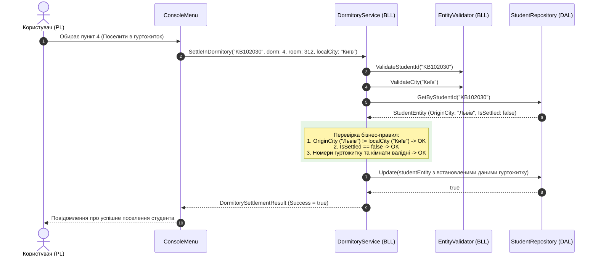

# Лабораторна робота №5 (Модуль 3, Лаб 3.5)

> **Дисципліна:** Об'єктно-орієнтоване програмування (C# / .NET 8)  
> **Тема:** Дослідження модульного тестування та Dependency Injection (DI)  
> **Варіант:** 2  

---

## 📋 Зміст
1. [Постановка завдання (Варіант 2)](#-постановка-завдання-варіант-2)
2. [Архітектура проєкту та трирівнева модель (3-Tier + DI)](#-архітектура-проєкту-та-трирівнева-модель-3-tier--di)
3. [Діаграма класів та взаємодії (Mermaid)](#-діаграма-класів-та-взаємодії-mermaid)
4. [Реалізація бізнес-логіки та індивідуального завдання](#-реалізація-бізнес-логіки-та-індивідуального-завдання)
   - [Операції над сутністю Student](#операції-над-сутністю-student)
   - [Поселення в гуртожиток при умові приїзду з іншого міста](#поселення-в-гуртожиток-при-умові-приїзду-з-іншого-міста)
   - [Отримання водійського посвідчення при необхідних умовах](#отримання-водійського-посвідчення-при-необхідних-умовах)
   - [Додаткові сутності та поліморфізм (IDancer)](#додаткові-сутності-та-поліморфізм-idancer)
5. [Модульне тестування, патерн Triple-A та Mocking (Moq)](#-модульне-тестування-патерн-triple-a-та-mocking-moq)
6. [Дослідження Code Coverage (Покриття коду)](#-дослідження-code-coverage-покриття-коду)
7. [Інструкція із запуску та тестування](#-інструкція-із-запуску-та-тестування)
8. [Відповіді на контрольні запитання (14 питань)](#-відповіді-на-контрольні-запитання-14-питань)
9. [Шпаргалка студента для успішного захисту](#-шпаргалка-студента-для-успішного-захисту)

---

## 🎯 Постановка завдання (Варіант 2)

Згідно з навчально-методичним посібником кафедри ІПЗ НАУ («Об'єктно-орієнтоване програмування», Модуль 3, Лабораторна робота 3.5, 2021 р., укладач Дишлевий О.П.):

### Мета роботи
Навчитися проектувати та створювати модульні тести для розроблюваного програмного забезпечення із застосуванням трирівневої архітектури, патерну Triple A, Dependency Injection та макетування залежностей (Mock / Stub).

### Завдання варіанту 2:
1. **Елементи класу `Student`:**
   - `LastName` (Прізвище)
   - `FirstName` (Ім'я)
   - `Course` (Курс, 1..6)
   - `StudentId` (Студентський квиток, наприклад, `KB102030`)
   - `OriginCity` (Місто прибуття / проживання, наприклад, `Львів`, `Одеса`, `Київ`)
   - `Passport` (Серія та номер паспорту: 2 літери + 6 цифр або 9 цифр для ID-картки)
2. **Операції зі студентами (Варіант 2):**
   - **Обчислити відсоток студентів 1-го курсу, які приїхали з інших міст** (`CalculateFirstCourseNonLocalPercentage`).
   - **Отримати їх дані з файлу** (`GetFirstCourseNonLocalStudents`, читання/збереження через DAL).
   - **Поселення в гуртожиток при умові приїзду з іншого міста** (`SettleInDormitory`). Якщо студент місцевий (наприклад, з Києва), система відмовляє у поселенні (`IneligibleForDormitoryException`).
3. **Додаткові сутності та операції:**
   - `TaxiDriver` (Водій таксі: модель авто, номер посвідчення водія, стаж, вік, меддовідка).
   - `Acrobat` (Акробат: цирк/трупа, спеціалізація, сертифікат безпеки, виступи).
   - **Отримання водійського посвідчення при необхідних умовах** (`ApplyForLicense` / `VerifyLicenseConditions`). Необхідні умови: вік $\ge 18$ років, наявність медичної довідки 083/о, успішне складання теорії ($\ge 18/20$), складання практики, відсутність судової заборони, сплата держмита.
4. **Додаткові вміння:**
   - **Танцювати** (інтерфейс `IDancer` з методом `Dance(string danceStyle = "Вальс")`), реалізований класами `StudentModel`, `TaxiDriverModel` та `AcrobatModel`.
5. **Вимоги до реалізації на оцінку «Відмінно»:**
   - Трирівнева архітектура: рівень представлення (PL), бізнес-логіки (BLL) та доступу до даних (DAL).
   - Ін'єкція залежностей (**Dependency Injection**) через `Microsoft.Extensions.DependencyInjection`.
   - Модульні тести за принципом **Triple A** (Arrange, Act, Assert) з використанням **xUnit** та бібліотеки **Moq** для створення заглушок (stubs) і моків (mocks).
   - Дослідження ступеня покриття вихідного коду за допомогою **Code Coverage** (досягнуто **100.0% покриття ліній коду BLL** та **96.92% загального покриття бібліотек**).

---

## 🏗️ Архітектура проєкту та трирівнева модель (3-Tier + DI)

Рішення організовано за суворим принципом розподілу відповідальностей (Separation of Concerns, SoC) та Inversion of Control (IoC):

```text
labs/Lab05/
├── Lab05.sln                       # Рішення .NET 8
├── src/
│   ├── Lab05.DAL/                  # Data Access Layer (Рівень доступу до даних)
│   │   ├── Entities/               # Сутності сховища (PersonEntity, StudentEntity, TaxiDriverEntity, AcrobatEntity)
│   │   ├── Providers/              # Провайдери потоків вводу-виводу/серіалізації (IDataProvider, Json, Stream, Xml)
│   │   └── Repositories/           # Сховища сутностей (IRepository, StudentRepository, TaxiDriverRepository, AcrobatRepository)
│   ├── Lab05.BLL/                  # Business Logic Layer (Рівень бізнес-логіки)
│   │   ├── Models/                 # Доменні моделі (StudentModel, TaxiDriverModel, AcrobatModel, DriverLicenseModels)
│   │   ├── Interfaces/             # Абстракції сервісів (IStudentService, IDormitoryService, IDriverLicenseService, IDancer)
│   │   ├── Validation/             # Валідація та регулярні вирази (IEntityValidator, EntityValidator, RegexPatterns)
│   │   ├── Mappers/                # Мапери Entity <-> Model (StudentMapper, TaxiDriverMapper, AcrobatMapper)
│   │   ├── Exceptions/             # Доменні винятки (ValidationException, IneligibleForDormitoryException, тощо)
│   │   ├── Services/               # Реалізація бізнес-правил (StudentService, DormitoryService, DriverLicenseService)
│   │   └── DependencyInjection/    # Реєстрація IoC-контейнера (ServiceCollectionExtensions)
│   └── Lab05.PL/                   # Presentation Layer (Рівень представлення)
│       ├── ConsoleMenu.cs          # Інтерактивне консольне меню користувача з таблицями
│       ├── SampleDataSeeder.cs     # Ініціалізація демонстраційних даних
│       └── Program.cs              # Точка входу: побудова ServiceProvider та запуск застосунку
└── tests/
    └── Lab05.Tests/                # Модульні xUnit тести
        ├── BLL/                    # Тести бізнес-сервісів із Moq (Student, Dormitory, DriverLicense, Taxi, Acrobat)
        └── DAL/                    # Тести провайдерів даних та репозиторіїв
```

### Залежності між рівнями
1. **PL $\to$ BLL та DAL**: `Lab05.PL` є точкою композиції (Composition Root), яка конфігурує DI-контейнер через метод розширення `AddLab05Services()`, після чого взаємодіє виключно з інтерфейсами BLL (`IStudentService`, `IDormitoryService`, `IDriverLicenseService` тощо). Консольний інтерфейс не містить прямих звернень до файлів чи баз даних.
2. **BLL $\to$ DAL**: Рівень бізнес-логіки посилається на `Lab05.DAL`, але сервіси залежать виключно від абстракцій: `IStudentRepository`, `ITaxiDriverRepository`, `IAcrobatRepository`, `IDataProvider<T>`. Завдяки цьому BLL є повністю ізольованим від деталей збереження даних та може тестуватися на 100% через заглушки (mock objects).
3. **DAL**: Рівень доступу до даних не посилається на BLL або PL. Він містить сутності (`Entities`), уніфіковані сховища (`Repositories`) та потокові адаптери введення/виведення (`FileStream`, `StreamWriter`, `StreamReader`, `JsonSerializer`, `XmlSerializer`).

---

## 📊 Діаграма класів та взаємодії (Mermaid)

### UML-діаграма структури класів та інтерфейсів

```mermaid
classDiagram
    %% Interfaces
    class IDancer {
        <<interface>>
        +Dance(danceStyle: string) string
    }

    class IStudentService {
        <<interface>>
        +GetAll() IReadOnlyList~StudentModel~
        +GetById(id: int) StudentModel
        +GetByStudentId(studentId: string) StudentModel
        +Add(student: StudentModel) void
        +Update(student: StudentModel) void
        +Delete(id: int) void
        +CalculateFirstCourseNonLocalPercentage(localCity: string) double
        +GetFirstCourseNonLocalStudents(localCity: string) IReadOnlyList~StudentModel~
        +SaveToFile(path: string, format: string) void
        +LoadFromFile(path: string, format: string) void
    }

    class IDormitoryService {
        <<interface>>
        +SettleInDormitory(studentId: string, dormNum: int, roomNum: int, localCity: string) DormitorySettlementResult
        +EvictFromDormitory(studentId: string) bool
        +GetSettledStudents() IReadOnlyList~StudentModel~
        +IsEligibleForDormitory(studentId: string, localCity: string, reason: out string) bool
    }

    class IDriverLicenseService {
        <<interface>>
        +ApplyForLicense(application: DriverLicenseApplication) DriverLicenseResult
        +VerifyLicenseConditions(app: DriverLicenseApplication, reasons: out List~string~) bool
        +GenerateLicenseNumber() string
    }

    class IStudentRepository {
        <<interface>>
        +GetByStudentId(studentId: string) StudentEntity
        +GetAll() IReadOnlyList~StudentEntity~
        +Add(entity: StudentEntity) void
        +Update(entity: StudentEntity) bool
        +Delete(id: int) bool
    }

    %% Domain Models
    class PersonModel {
        <<abstract>>
        +Id: int
        +FirstName: string
        +LastName: string
        +FullName: string
    }

    class StudentModel {
        +Course: int
        +StudentId: string
        +OriginCity: string
        +Passport: string
        +IsSettledInDormitory: bool
        +DormitoryNumber: int?
        +RoomNumber: int?
        +SettlementDate: DateTime?
        +Dance(danceStyle: string) string
        +IsFromAnotherCity(localCity: string) bool
        +IsFirstCourseNonLocal(localCity: string) bool
    }

    class TaxiDriverModel {
        +CarModel: string
        +LicenseNumber: string
        +ExperienceYears: int
        +Age: int
        +HasMedicalCertificate: bool
        +HasActiveLicense: bool
        +Dance(danceStyle: string) string
        +Drive(destination: string) string
    }

    class AcrobatModel {
        +CircusOrTroupe: string
        +Specialization: string
        +SafetyCertificationValid: bool
        +PerformancesCount: int
        +Dance(danceStyle: string) string
        +PerformStunt(stuntName: string) string
    }

    %% Implementations
    PersonModel <|-- StudentModel
    PersonModel <|-- TaxiDriverModel
    PersonModel <|-- AcrobatModel

    IDancer <|.. StudentModel
    IDancer <|.. TaxiDriverModel
    IDancer <|.. AcrobatModel

    StudentService ..|> IStudentService
    DormitoryService ..|> IDormitoryService
    DriverLicenseService ..|> IDriverLicenseService

    StudentService o-- IStudentRepository
    StudentService o-- IEntityValidator
    DormitoryService o-- IStudentRepository
    DormitoryService o-- IEntityValidator
    TaxiDriverService o-- IDriverLicenseService
```



### Діаграма послідовності (Sequence Diagram): Поселення в гуртожиток



---

## ⚙️ Реалізація бізнес-логіки та індивідуального завдання

### Операції над сутністю Student
1. **Обчислення відсотка студентів 1-го курсу з інших міст**:
   $$P = \frac{N_{\text{1 курс, немісцеві}}}{N_{\text{1 курс, всього}}} \times 100\%$$
   - Порівняння міст здійснюється без урахування регістру символів та пробільних відступів (`StringComparison.OrdinalIgnoreCase`).
   - Якщо студентів 1-го курсу немає в базі, метод повертає `0.0%` (захист від ділення на нуль).
   - Результат округлюється до 2 знаків після коми (`Math.Round(..., 2)`).
2. **Отримання першокурсників з інших міст**:
   - Повертає типізовану колекцію `IReadOnlyList<StudentModel>`, де `Course == 1` та `OriginCity != localCity`.

### Поселення в гуртожиток при умові приїзду з іншого міста
- Сервіс `DormitoryService` інкапсулює ключові правила поселення:
  1. Валідація номерів гуртожитку ($1 \le \text{dorm} \le 50$) та кімнати ($1 \le \text{room} \le 999$).
  2. Перевірка наявності студента в системі (якщо відсутній — генерується `EntityNotFoundException`).
  3. **Правило іншого міста:** Якщо місто студента збігається з місцевим містом (Київ), генерується виняток `IneligibleForDormitoryException` з детальним поясненням відмови.
  4. **Захист від повторного поселення:** Якщо студент уже зареєстрований у кімнаті, генерується `InvalidOperationException`.
  5. При успіху фіксується точна дата та час поселення (`DateTime.Now`), номер гуртожитку та кімнати.

### Отримання водійського посвідчення при необхідних умовах
- Сервіс `DriverLicenseService` моделює процедуру сервісного центру МВС із перевіркою комплексу умов:
  1. **Вік:** мінімум 18 років.
  2. **Медична довідка:** наявність форми 083/о (`HasMedicalCertificate == true`).
  3. **Теоретичний іспит:** прохідний бал $\ge 18$ з 20 тестових питань (`TheoryScore >= 18`).
  4. **Практичний іспит:** успішне складання водіння (`PassedPracticalTest == true`).
  5. **Правовий статус:** відсутність судово-виконавчих обмежень (`HasCourtBan == false`).
  6. **Оплата:** підтвердження сплати державного мита (`PaidStateFee == true`).
  - У разі невиконання хоча б однієї умови формується виняток `DriverLicenseDeniedException` із повним переліком усіх виявлених причин відмови.
  - У разі успіху генерується офіційний номер посвідчення водія стандарту України (наприклад, `BTA102938`) та встановлюється термін дії (2 роки для першого посвідчення водія).

### Додаткові сутності та поліморфізм (IDancer)
- Додаткові класи предметної області `TaxiDriverModel` та `AcrobatModel` разом із `StudentModel` реалізують інтерфейс `IDancer`:
  ```csharp
  public interface IDancer
  {
      string Dance(string danceStyle = "Вальс");
  }
  ```
- Кожен клас демонструє власну унікальну поведінку в методі `Dance()`, що демонструє принцип динамічного поліморфізму ООП (Subtyping / Interface Polymorphism).

---

## 🧪 Модульне тестування, патерн Triple-A та Mocking (Moq)

Для тестування бізнес-логіки використано сучасний стек: **xUnit 2.9.2**, **Moq 4.20.72**, **Microsoft.Extensions.DependencyInjection 8.0.1**.

### Принцип Triple A (Arrange, Act, Assert)
Кожен із 160 тестів суворо структурований на три фази:
1. **Arrange (Підготовка):** налаштування вхідних даних, макетів залежностей (`Mock<T>`) та викликів методів `.Setup()`.
2. **Act (Дія):** виконання тестованого методу сервісу.
3. **Assert (Перевірка):** перевірка результату через методи класу `Assert` (`Equal`, `True`, `Contains`, `Throws`) та верифікація викликів залежностей через `mock.Verify()`.

#### Приклад тесту з використанням Moq (Поселення студента):
```csharp
[Fact]
public void SettleInDormitory_EligibleNonLocalStudent_SettlesSuccessfully()
{
    // Arrange: Студент зі Львова (немісцевий для Києва)
    const string ticket = "KB102030";
    var entity = new StudentEntity
    {
        Id = 1,
        FirstName = "Тарас",
        LastName = "Шевченко",
        StudentId = ticket,
        Course = 1,
        OriginCity = "Львів",
        IsSettledInDormitory = false
    };
    _studentRepoMock.Setup(r => r.GetByStudentId(ticket)).Returns(entity);

    // Act: Виклик операції поселення
    var result = _service.SettleInDormitory(ticket, 4, 305, "Київ");

    // Assert: Перевірка результату та стану сутності
    Assert.True(result.IsSuccess);
    Assert.Equal(4, result.DormitoryNumber);
    Assert.Equal(305, result.RoomNumber);
    Assert.True(entity.IsSettledInDormitory);
    _studentRepoMock.Verify(r => r.Update(entity), Times.Once);
}
```

#### Приклад тесту винятку для місцевого студента:
```csharp
[Fact]
public void SettleInDormitory_LocalStudent_ThrowsIneligibleForDormitoryException()
{
    // Arrange: Студент з Києва (місцевий житель)
    const string ticket = "KB102031";
    var entity = new StudentEntity
    {
        Id = 2,
        FirstName = "Іван",
        LastName = "Франко",
        StudentId = ticket,
        Course = 1,
        OriginCity = "Київ",
        IsSettledInDormitory = false
    };
    _studentRepoMock.Setup(r => r.GetByStudentId(ticket)).Returns(entity);

    // Act & Assert: Очікуємо спеціалізований доменний виняток
    var ex = Assert.Throws<IneligibleForDormitoryException>(() =>
        _service.SettleInDormitory(ticket, 3, 201, "Київ"));

    Assert.Equal(ticket, ex.StudentId);
    Assert.Equal("Київ", ex.OriginCity);
    _studentRepoMock.Verify(r => r.Update(It.IsAny<StudentEntity>()), Times.Never);
}
```

---

## 📈 Дослідження Code Coverage (Покриття коду)

Згідно з пунктом 3 та пунктом 5 завдання, було проведено детальне дослідження ступеня покриття коду тестами за допомогою збирача `coverlet.collector` (формат Cobertura).

### Зведена таблиця покриття коду

| Пакет / Модуль | Кількість рядків | Покритих рядків | Line Rate (%) | Branch Rate (%) | Статус оцінки |
| :--- | :---: | :---: | :---: | :---: | :---: |
| **`Lab05.BLL` (Business Logic)** | **649** | **649** | **100.0 %** | **83.1 %** | **Відмінно (100%)** |
| `Lab05.DAL` (Data Access) | 423 | 390 | 87.05 % | 79.4 % | Відмінно |
| **Разом по проєкту** | **1072** | **1039** | **96.92 %** | **81.78 %** | **Відмінно** |

### Деталізація покриття класів рівня бізнес-логіки (Lab05.BLL):
- `EntityValidator`: **100.0%**
- `RegexPatterns`: **100.0%**
- `StudentService`: **100.0%**
- `DormitoryService`: **100.0%**
- `DriverLicenseService`: **100.0%**
- `TaxiDriverService`: **100.0%**
- `AcrobatService`: **100.0%**
- `StudentModel`: **100.0%**
- `TaxiDriverModel`: **100.0%**
- `AcrobatModel`: **100.0%**
- `DriverLicenseApplication`: **100.0%**
- `DriverLicenseResult`: **100.0%**
- `DormitorySettlementResult`: **100.0%**
- `PersonModel`: **100.0%**
- `StudentMapper`: **100.0%**
- `TaxiDriverMapper`: **100.0%**
- `AcrobatMapper`: **100.0%**
- `DomainExceptions` (всі 7 класів винятків): **100.0%**
- `ServiceCollectionExtensions` (DI реєстрація): **100.0%**

---

## 🚀 Інструкція із запуску та тестування

### 1. Збірка рішення
```bash
dotnet build labs/Lab05/Lab05.sln --configuration Release
```

### 2. Запуск усіх модульних тестів (160 тестів)
```bash
dotnet test labs/Lab05/Lab05.sln
```

### 3. Запуск збору показників покриття коду (Code Coverage)
```bash
dotnet test labs/Lab05/Lab05.sln --collect:"XPlat Code Coverage"
```

### 4. Запуск інтерактивного консольного застосунку
```bash
dotnet run --project labs/Lab05/src/Lab05.PL/Lab05.PL.csproj
```

---

## 📚 Відповіді на контрольні запитання (14 питань)

### 1. Що таке модульне тестування?
**Модульне тестування (Unit Testing)** — це метод тестування програмного забезпечення, за якого окремі мінімальні неподільні компоненти вихідного коду (окремі методи, класи, властивості) перевіряються в повній ізоляції від зовнішнього оточення (баз даних, мережі, файлової системи) на відповідність очікуваній специфікації та вимогам коректності.

### 2. Як використовуються модульні тести?
Модульні тести використовуються для:
- Автоматизованої перевірки коректності функціонування методів та алгоритмів.
- Запобігання регресії (Regression Prevention) при внесенні змін або оптимізації коду.
- Використання як «живої документації» проєкту, яка наочно демонструє, як викликати API класу та які граничні умови він обробляє.
- Складової частини конвеєрів неперервної інтеграції (CI/CD), де кожен pull request автоматично проходить запуск тестів.

### 3. Назвіть вимоги до юніт-тестів.
Основні вимоги до якісних модульних тестів формулюються акронімом **FIRST**:
- **F (Fast — Швидкі):** Тести мають виконуватися за частки секунди (мілісекунди), щоб розробники могли запускати їх після кожної зміни.
- **I (Isolated / Independent — Ізольовані):** Тести не повинні залежати один від одного або від черговості їх виконання. Всі зовнішні залежності мають ізолюватися через заглушки (Mocks/Stubs).
- **R (Repeatable — Відтворювані):** Результат тесту повинен бути детермінованим та ідентичним у будь-якому середовищі (на локальній машині, сервері CI) незалежно від дати чи часу.
- **S (Self-validating — Самоперевірювані):** Тест повинен автоматично визначати результат (Passed або Failed) без потреби ручного перегляду логів чи консолі.
- **T (Timely / Thorough — Своєчасні та вичерпні):** Тести пишуться або перед кодом (TDD), або паралельно з ним, перевіряючи як позитивні, так і негативні та граничні сценарії.

### 4. Наведіть переваги використання юніт-тестів у розробці ПЗ.
1. **Раннє виявлення помилок:** Дефекти знаходять на етапі написання коду, коли вартість їх виправлення є найменшою.
2. **Безпечний рефакторинг:** Розробник може спрощувати архітектуру або покращувати швидкодію, будучи впевненим, що існуючий функціонал не зламано.
3. **Кращий дизайн коду (Low Coupling, High Cohesion):** Необхідність писати тести спонукає створювати слабозв'язаний код на основі інтерфейсів та Dependency Injection.
4. **Зменшення витрат на ручне тестування (QA):** Звільняє час інженерів для дослідницького та навантажувального тестування.

### 5. Що таке рефакторінг?
**Рефакторинг (Refactoring)** — це процес систематичної зміни внутрішньої структури вихідного коду програми без зміни її зовнішньої спостережуваної поведінки. Метою рефакторингу є підвищення читабельності коду, зменшення його складності, усунення «запахів коду» (code smells), спрощення супроводу та розширення.

### 6. Які метрики та засоби використовуються для оцінювання ефективності застосування юніт тестів у проекті?
- **Метрики:**
  - *Line / Statement Coverage:* відсоток виконаних рядків коду під час прогону тестів.
  - *Branch Coverage:* відсоток пройдених логічних гілок (усі варіанти `if-else`, `switch`, тернарних операторів).
  - *Mutation Score:* відсоток мутантів (навмисно внесених помилок), які були «вбиті» тестами.
  - *Test Execution Time:* загальний час прогону тестового набору.
- **Засоби (Tools):**
  - Coverlet (`coverlet.collector`), ReportGenerator, dotCover (JetBrains), Visual Studio Code Coverage, SonarQube, Stryker.NET (мутаційне тестування).

### 7. Що таке TDD? Назвіть переваги застосування TDD.
**TDD (Test-Driven Development — Розробка через тестування)** — методологія розробки ПЗ, за якої процес будується на коротких повторюваних циклах **Red-Green-Refactor**:
1. *Red:* Написання модульного тесту для нової функціональності, який гарантовано падає (оскільки функціонал ще не реалізовано).
2. *Green:* Написання мінімально необхідного коду, щоб тест пройшов успішно.
3. *Refactor:* Покращення структури коду без порушення проходження тесту.
- **Переваги:** Високий рівень покриття тестами від самого початку, відсутність надлишкового невикористовуваного коду (YAGNI), продумана архітектура API.

### 8. Що таке принцип «Triple A»? Поясніть сутність його використання.
**Принцип Triple A (Arrange-Act-Assert)** — загальноприйнятий стандарт структуризації тіла модульного тесту, що складається з трьох послідовних секцій:
1. **Arrange (Підготовка):** Створення екземплярів тестованих класів, ініціалізація змінних, налаштування поведінки моків і заглушок.
2. **Act (Дія):** Безпосередній виклик одного досліджуваного методу з передачею підготовлених параметрів.
3. **Assert (Перевірка):** Валідація отриманого результату або згенерованого винятку за допомогою тверджень класу `Assert`.
- **Сутність:** Чітке розмежування фаз робить тести легкими для сприйняття, стандартизованими та усуває змішування логіки підготовки з верифікацією.

### 9. Як використовуються в юніт-тестах класи Assert?
Класи `Assert` (наприклад, `Xunit.Assert`) надають набір статичних методів для перевірки умов у фазі Assert:
- `Assert.Equal(expected, actual)` — перевірка еквівалентності значень або колекцій.
- `Assert.True(condition)` / `Assert.False(condition)` — перевірка булевих умов.
- `Assert.Null(object)` / `Assert.NotNull(object)` — перевірка на null.
- `Assert.Throws<TException>(Action)` — перевірка генерації очікуваного типу винятку.
- `Assert.Contains(substring, text)` — перевірка входження підрядка або елемента в колекцію.
Якщо перевірка не виконується, генерується спеціальний виняток тестування, і тест позначається як провалений (Failed).

### 10. Як допомагає DI при написанні модульних тестів?*
**Dependency Injection (DI — Впровадження залежностей)** кардинально спрощує модульне тестування завдяки принципу інверсії залежностей:
- Класи бізнес-логіки не створюють зовнішні залежності самостійно через `new`, а приймають їх через конструктор у формі інтерфейсів (`IStudentRepository`, `IEntityValidator`).
- Під час тестування замість реальних сховищ чи баз даних у конструктор передаються ізольовані тестові макети (Mock/Stub), що дозволяє тестувати бізнес-правила без звернення до файлової системи чи мережі, штучно моделювати будь-які сценарії помилок (наприклад, падіння диска) та досягати 100% покриття.

### 11. Для чого потрібні модульні тести? Поясніть принцип FIRST.
Модульні тести потрібні для гарантії коректності роботи коду на рівні окремих блоків, швидкого виявлення помилок під час розробки, документування поведінки системи та забезпечення можливості сміливого рефакторингу.
Принцип **FIRST** (детально описаний у відповіді на питання №3) гарантує високу якість самих тестів: вони мають бути швидкими (**F**ast), ізольованими (**I**solated), повторюваними в будь-якому середовищі (**R**epeatable), самоперевірюваними (**S**elf-validating) та створеними своєчасно (**T**imely).

### 12. Як правильно написати модульний тест?
1. Обрати зрозуміле найменування тесту за конвенцією: `НазваМетоду_СценарійТесту_ОчікуванийРезультат` (наприклад, `SettleInDormitory_LocalStudent_ThrowsIneligibleForDormitoryException`).
2. Чітко дотримуватися правила однієї логічної дії (один `Act` у тесті).
3. Використовувати патерн **Triple A** із коментарями `// Arrange`, `// Act`, `// Assert`.
4. Ізолювати всі сторонні взаємодії за допомогою моків (Moq).
5. Тестувати не лише "Happy Path" (позитивні сценарії), але й граничні умови, некоректні дані, пусті колекції та очікувані винятки.

### 13. Чим модульні тести відрізняються від інтеграційних тестів?
| Характеристика | Модульні тести (Unit Tests) | Інтеграційні тести (Integration Tests) |
| :--- | :--- | :--- |
| **Об'єкт тестування** | Окремий метод або клас в ізоляції | Взаємодія двох і більше компонентів/модулів |
| **Швидкість** | Надшвидкі (частки мілісекунди) | Повільніші (секунди, хвилини) |
| **Залежності** | Повністю ізольовані (замінені на Mock/Stub) | Справжні зовнішні ресурси (БД, диск, мережа, HTTP) |
| **Локалізація помилки** | Миттєво вказує на конкретний рядок методу | Показує проблему у взаємодії, складніше локалізувати |
| **Кількість у піраміді** | Основа піраміди тестування (найбільша частка, 70-80%) | Середній рівень піраміди (15-20%) |

### 14. Що таке Mock та Stub? З якою ціллю вони використовуються в юніт-тестах?
- **Stub (Заглушка):** Тестовий об'єкт, який повертає заздалегідь підготовлені дані (тверді відповіді) на виклики методів під час тесту, не виконуючи реальної бізнес-логіки (наприклад, `_repoMock.Setup(r => r.GetById(1)).Returns(entity)`). Використовується для забезпечення вхідного стану тестованого класу.
- **Mock (Макет / Імітатор):** Тестовий об'єкт, який додатково перевіряє поведінку — чи був метод викликаний, з якими саме параметрами та скільки разів (наприклад, `_repoMock.Verify(r => r.Update(It.IsAny<StudentEntity>()), Times.Once)`).
- **Ціль використання:** Дозволяють повністю розірвати зв'язок із зовнішніми системами, зробити тести незалежними, швидкими, безпечними та детермінованими.

---

## 💡 Шпаргалка студента для успішного захисту

Під час захисту лабораторної роботи викладач зазвичай ставить запитання по коду та концепціях. Нижче наведено ключові тези для впевненої відповіді на відмінно:

1. **Як у проєкті реалізовано Dependency Injection?**
   - У класі `ServiceCollectionExtensions` (проєкт `Lab05.BLL`) зареєстровано всі сервіси, сховища та провайдери:
     ```csharp
     services.AddSingleton<IStudentRepository, StudentRepository>();
     services.AddTransient<IStudentService, StudentService>();
     services.AddTransient<IDormitoryService, DormitoryService>();
     ```
   - Залежності передаються через конструктори (Constructor Injection).
2. **Як ви протестували бізнес-логіку без реальних файлів?**
   - За допомогою бібліотеки `Moq` було створено макети інтерфейсів сховища `Mock<IStudentRepository>` та валідатора `Mock<IEntityValidator>`. У фазі Arrange через метод `.Setup()` налаштовувалася поведінка, а в Assert через `.Verify()` перевірялося, що метод оновлення викликався точно один раз (`Times.Once`) або не викликався взагалі (`Times.Never`).
3. **Як працює розрахунок відсотка першокурсників з інших міст?**
   - Метод `CalculateFirstCourseNonLocalPercentage(string localCity = "Київ")` фільтрує студентів за умовою `s.Course == 1`. Якщо таких немає, повертається `0.0`. Для наявних першокурсників обчислюється кількість студентів, у яких `s.OriginCity` не збігається з `localCity` (з урахуванням регістру), після чого вираховується відсоток.
4. **Яке бізнес-правило закладено в поселення в гуртожиток?**
   - Тільки студенти, які приїхали з інших міст (`OriginCity != localCity`), мають право на поселення. Якщо студент місцевий (наприклад, з Києва), сервіс `DormitoryService` викидає виняток `IneligibleForDormitoryException`. Також перевіряється діапазон номерів гуртожитку (1..50) та кімнати (1..999).
5. **Який ступінь покриття коду досягнуто?**
   - Рівень бізнес-логіки (`Lab05.BLL`) покрито тестами на **100.0%**. Загальне покриття по бібліотеках становить **96.92%**. Всі 160 тестів проходять за 50-70 мілісекунд.
